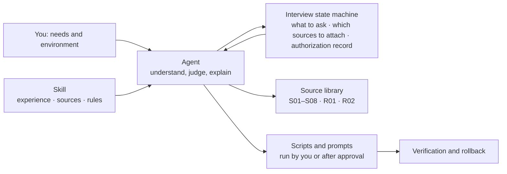
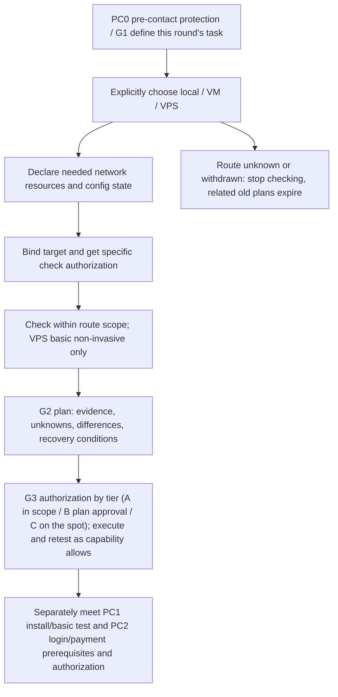

<div align="center">

# Claude-Guardian

**Your Agent, armed with real-world experience, helps you prepare, check and stabilize your Claude environment.**

Pre-subscription prep · Account signup and pacing · Fixed egress IP · Local / VM / VPS routes · Firewall and route optimization · Tiered authorization

[中文](README.md) · **English**

[What it does](#what-it-does) · [How it works](#how-it-works) · [Tiered authorization](#tiered-authorization-you-dont-need-to-be-there-for-every-step) · [Quick start](#quick-start) · [Choosing a route](#choosing-a-route) · [Docs](#documentation)

[GPL-3.0-only](LICENSE) · [Changelog](CHANGELOG.md) · [Decision log](docs/decisions.md) · [Report an issue](https://github.com/DUNHKpcc/Claude-Guardian/issues)

</div>

---

Claude-Guardian is a Skill for Agents. It is not a one-click fixer. It hands your Agent the author's and community's real experience, a curated body of source material and a few scripts, so the Agent can walk you through preparing your subscription, account, network egress and runtime environment **according to your needs and setup**. Everyone's system, network, budget and goals differ, so it gives no fixed answer: it learns about you first, suggests what fits, and leaves high-risk steps for you to decide.

> **No promise of avoiding bans.** Passing checks or having a clean egress does not mean the platform accepts your network environment. Prices and access change fast; verify official pages before buying.

> The Chinese [README.md](README.md) is the source text. This English version is a translation and may lag behind it; where they differ, the Chinese version wins. The source library under `skills/` is in Chinese.

## What it does

| | Capability | What it does |
| --- | --- | --- |
| 🧭 | **Route selection** | Helps you choose between local, virtual machine (VM) and remote server (VPS), explaining each route's scope, cost and who it suits |
| 🌐 | **Fixed egress IP** | Compares three sources (clean airport/proxy service, self-built proxy optionally with a residential exit, shared residential line) and their trade-offs; a short prompt for a self-built `3x-ui` + optimized-route VPS; 17 recommendation reports when picking a VPS |
| 📝 | **Signup and account pacing** | Email signup, Gmail / Outlook / Proton, Free → Pro → Max intervals, quota use, education email; an anti-ban checklist for mobile (iOS / Android) |
| 💳 | **Subscription and payment** | Picks candidates from the "all AI payment methods" summary by your region, device and budget and explains the risks; you always pay yourself |
| 🖥️ | **VM route** | Guest OS (Omarchy / macOS), dedicated LAN NIC, build order, and a fail-closed `FlClash TUN` + `nftables` firewall script |
| ☁️ | **VPS route** | Use a VPS as the dev machine: Ubuntu 24.04, consistent environment, `Xvfb + noVNC` remote desktop, VS Code Remote-SSH, `tmux`, inbound firewall script |
| 💻 | **Local route** | Clash Verge / FlClash TUN and DNS setup, Windows firewall, LuLu on Mac, guided step by step with prompts |
| 🔒 | **Whole-machine uniform egress** | IPv4 only, no IPv6: strict TUN routing, DNS, fallback rules, and evidence checklists for leak and failure drills (Mac, Windows). `egress_verifier.py` rules `established / violated / incomplete` from the evidence you actually observed, without echoing the IP |
| 📈 | **Route optimization** | The Agent diagnoses and tunes the route item by item: SSH dynamic forwarding, Realm relay, BBR, each with a recorded original value and a rollback |
| 🩺 | **Failure triage** | `403` / `429` / `529`, billing conflicts, suspected credential leaks: pause retries, gather evidence, then propose the next step |
| 🧹 | **Cleanup planning** | Plans cleanup of Claude leftovers on an old device while protecting source code, Git history and Codex; isolation (recoverable) is confirmed by you in a terminal, nothing is permanently deleted; Windows uses step-by-step PowerShell on official paths |
| 📚 | **Sources with every answer** | Each answer links its sources; beyond them it can search Linux.do, NodeSeek, IDC Flare, V2EX, Reddit and X, labelling source and date; also usable as a search tool for VPS, residential-IP, route and ban-experience posts |

## What it is not

- **Not a one-click fixer.** The built-in config-write adapter currently covers only the rules extension of Clash Verge Rev 2.5.8 on Mac (the app must be quit first; the refusal paths, plan, real write and rollback were verified item by item on a real Mac, see ADR-039). Any other change needs your approval and is performed by you or the Agent within what you approved.
- **Does not pay, sign up, log in, do KYC or OAuth for you.** You always do these yourself.
- **Does not collect credentials.** You never submit IPs, subscription links, passwords, UUIDs or full configs.
- **Does not touch Claude / Anthropic.** The pre-contact phase (PC0) does not start the client, log in or reach its services.
- **Not a set of scripts that run unmodified anywhere.** The author used and verified these tutorials and scripts on their own Mac, Windows, VM and VPS (see [Development and verification](#development-and-verification)), but system versions, app versions, networks and install locations differ, so they need adjusting to your environment: your Agent checks the environment first, adapts to the differences, and rolls back and reports honestly on failure.

## How it works



- **Agent-led:** understands your needs, picks sources, explains results and decides the next step. The same Skill gives different people different approaches.
- **State machine as a backstop:** over a hundred interview questions are scheduled by condition, and route-specific questions are asked only after you explicitly choose a route; each assessment lists the **sources that must be attached**; authorization records are traceable.
- **Scripts do limited things:** VM setup, firewall and similar scripts are run by you or after approval, not rewritten ad hoc by the Agent.
- **Hard rules are not the Agent's call:** the contact gate, payment by you, no credential collection, host policy first.

## Tiered authorization: you don't need to be there for every step

Only the points that really matter need you. Changes fall into three tiers by risk; see [authorization tiers](skills/claude-guardian/references/authorization-tiers.md):

| Tier | What you do | Includes |
| --- | --- | --- |
| 🟢 **A: do within scope** | Confirm the scope once after route and goal are set | Read-only diagnosis, research, proposals, dry runs |
| 🟡 **B: approve the whole plan once** | Approve one plan; the Agent runs it continuously and undoes it on failure | Installing a client, adding allow rules, foreground forwarding, temporary BBR switch, installing TUN |
| 🔴 **C: confirm on the spot** | The Agent pauses at that step; reply whenever you see it | Default-outbound block, enabling a firewall, SSH changes, persistent kernel changes, data cleanup, accounts and money, credentials, organization devices, contacting Claude |

Scope confirmations, plan approvals and confirmation sheets are recorded in the interview state, must come from your explicit reply, and expire automatically on a route change or session resume; the Agent cannot approve for you.

## Quick start

### 1. Install the Skill

Copy the [`skills/claude-guardian`](skills/claude-guardian) folder from this repository into the Codex Skill directory you use, keeping its internal structure. Keep the root [LICENSE](LICENSE) when redistributing.

- Requires Codex with Skills support; scripts need **Python 3.10+**
- The Skill and references can be read directly; you can look things up without running any script
- The project never installs Python, proxy tools or background services by itself; some static YAML features need the optional PyYAML and stop with an explanation if it is missing

On macOS / Linux, run in Bash (skip `git clone` if you already have the repository):

```bash
git clone https://github.com/DUNHKpcc/Claude-Guardian.git
(
  set -eu
  skill_root="$HOME/.codex/skills"
  mkdir -p "$skill_root"
  if [ -e "$skill_root/claude-guardian" ] || [ -L "$skill_root/claude-guardian" ]; then
    printf '%s\n' 'Target exists; stopping. Inspect and back up the existing Skill, then migrate by hand.' >&2
    exit 1
  fi
  cp -R Claude-Guardian/skills/claude-guardian "$skill_root/claude-guardian"
)
```

You should end up with `~/.codex/skills/claude-guardian/SKILL.md`. The command stops on an existing target (including symlinks) to avoid nested copies or overwriting customizations; to update, inspect the diff, back up, and migrate the files you need by hand.

On Windows, download or clone the repository, create any missing parent directories in your Codex Skill directory (usually `%USERPROFILE%\.codex\skills`), and copy the whole `claude-guardian` folder there. Confirm the result is `skills\claude-guardian\SKILL.md`; if a same-named target exists, inspect, back up and migrate by hand rather than merging or overwriting.

### 2. Start a conversation in Codex

```text
$claude-guardian
I'm preparing my first Claude subscription, on a Mac. Compare local and VM first, then decide how to check.
```

Ordinary subscription prep first confirms the subscription stage, then asks about system, use and goals as needed. Existing answers are reused; urgent failures and explicit cleanup tasks follow their own flows without redoing the purchase questionnaire.

### 3. Confirm the route, then start checking

**Define this round's task → explicitly choose local / VM / VPS → declare needed network resources and config state → authorize specific checks → run checks → plan and tiered authorization**

Choosing a route only fixes the target and depth of checking; it does not permit network access, config changes or saving data. If you only want to understand the subscription or compare options, you can stay at the explanation stage.

## Choosing a route

| Route | Fits | Current check scope |
| --- | --- | --- |
| **Local** `Clash Verge` `FlClash` `LuLu` `Windows Firewall` | Using your own Mac / Windows; the default suggestion, still needs explicit acceptance | Detailed checks as the goal and host capability allow; for fixed egress IP sources (airport, self-built proxy, shared residential) see [egress sources](skills/claude-guardian/references/egress-ip-options.md) |
| **VM** `Omarchy` `macOS` `FlClash TUN` `nftables` | A separate working environment inside a virtual machine | Deeper checks within scope; host and guest are bound separately and neither can stand in for the other's conclusions; guest OS preferably Omarchy (macOS on a Mac host), NIC a dedicated LAN one; see the [VM guide](skills/claude-guardian/references/vm-guidance.md) for build order and firewall scripts |
| **VPS** `Ubuntu 24.04` `Xvfb + noVNC` `Remote-SSH` `tmux` | Explicitly choosing a remote server as the dev machine (Claude Code runs on the VPS) | Basic, non-invasive checks; see the [VPS guide](skills/claude-guardian/references/vps-guidance.md) for consistent environment, remote desktop, firewall and route optimization. Once you have bought a server and give SSH access, the Agent can deploy over shell / SSH under tiered authorization (the Skill has no built-in deployer and the scripts are not tested on real hardware); buying and paying are yours |

The three routes share one entry and detection core and differ in target, scope and depth. Native collection depends on the specific host; `guardian.py check` currently supports only local macOS / Windows, and choosing VM or VPS does not open native collection for that command. They are independent choices, not an upgrade path; already having a VPS, or using one as a network exit, does not mean you chose to run on the VPS.

After choosing a route, first confirm whether network resources exist, which resource alias is selected, the proxy entry and final egress type, and whether the config is ready. **You never submit IPs, subscription links, passwords, UUIDs or full configs.** With no resources, if unsure, or choosing direct, you can still run an offline pre-check under a clear goal and authorization, without buying anything first.

A local HTTP/mixed entry and an upstream SOCKS5 exit are different layers, and an imported config is not necessarily in effect. See [environment entry and route boundaries](docs/environment-entry-decision.md).

When the route is unknown, compare-only, refused, withdrawn, expired or conflicting, checking does not continue on the target and earlier route confirmations cannot be reused. After a route, target, resource or config change, related bindings, confirmations and old plans expire and must be re-verified; existing recovery obligations remain.

## Core scenarios

| Scenario | Problem | Current handling |
| --- | --- | --- |
| **Pre-subscription prep and channel check** | Unclear difference between local, VM and VPS, or payment-channel and store-region prerequisites | Confirm the subscription stage and use first; choose a route before any environment check. Check channel prerequisites one by one, keep unknowns as unknown, never rush a purchase |
| **Proxy and traffic-split diagnosis** | Config imported but unsure it works, worried about DNS, IPv6 or WebRTC paths | Check applicable evidence under the chosen route and specific authorization, plan minimal changes for Claude target traffic as `IPv4_ONLY`; active endpoint probes need separate authorization |
| **Client errors and triage** | `403` / `429` / `529`, billing conflicts or suspected credential leaks | Pause non-essential retries, gather existing evidence, separate transport, auth, quota, billing and account state, then propose the next step |
| **Cleanup planning for old-device leftovers** | Need to tidy local Claude leftovers while protecting source, Git history and Codex | State exact ownership, protected items and an isolate/restore plan; the cleanup interface has no host adapter by default, so do not claim it is executable or accepted |

## Workflow and gates



- **PC0** keeps the contact gate closed: no client start, no `claude --version`, no access to or parsing of Claude / Anthropic services; passing diagnostics never opens the gate on its own.
- **G1 → G2 → G3** organize fact gathering, the plan, and tiered authorization (A in scope, B plan approved once, C confirmed on the spot). Choosing a route or finishing the questionnaire satisfies only part of the entry prerequisites and does not replace authorization to check, change or go online.
- **PC1 / PC2** (client install, basic test, official login and payment) have their own conditions and authorization; reaching the end of the flowchart does not make them executable. VPS purchase and payment are done by you; once you give SSH access, the Agent can run the documented commands and scripts over shell / SSH under tiered authorization to deploy a VM or VPS (no built-in deployer, not tested on real hardware).

Cleaning local Claude data: macOS has a built-in host, see the [cleanup interface guide](docs/cleanup-cli-usage.md); Windows has no host and uses a [PowerShell prompt](skills/claude-guardian/references/windows-cleanup.md) based on the official paths.

### Before you start

- **Confirm first, then touch services:** PC0 (the pre-contact phase) does not start the Claude client, log in or access its services; reading a command in a source is not authorization to run it
- **Changes are authorized by risk tier:** read-only and dry runs proceed within confirmed scope; self-reversible changes that do not cut off access need one plan approval; steps that can lock you out, involve accounts and money, credentials, deletion or are irreversible need on-the-spot confirmation. You need not be present for every step; see [authorization tiers](skills/claude-guardian/references/authorization-tiers.md)
- **Protect other apps:** the plan requires the chosen Claude target traffic to use IPv4 only with no IPv6 fallback; this is not a claim that it is in effect, and does not authorize disabling IPv6 machine-wide or affecting Codex, VPNs or other apps
- **Save only what is necessary:** reports and private diffs are saved on explicit request; credentials, real IPs, subscription links, raw configs and personal reports are never committed to the repository

For the full rules see [contact and authorization boundaries](skills/claude-guardian/references/contact-and-safety.md) and the [network evidence notes](skills/claude-guardian/references/network-and-remedies.md).

## Examples

These are examples of tasks to give Codex, not demonstrations of completed checks or fixes.

| What you want | What to say |
| --- | --- |
| Prepare a first subscription | "I'm on Windows and preparing my first subscription. Explain what needs confirming, then decide the route." |
| Local route, check the network | "I'm using this locally and the proxy config is imported. Confirm resources and config state first, and only run checks I agree to." |
| Compare VM and VPS | "Compare the check scope of the two routes. Don't check any device or deploy anything yet." |
| Handle an existing error | "Claude Code is erroring. Gather existing evidence, separate confirmed from unknown, then give the smallest fix." |

<details>
<summary><strong>For developers: command-line entry points</strong></summary>

Run these from the repository root. `interview_cli.py` is recommended for the full interview; `guardian.py interview` is a simplified compatible entry.

```sh
python3 skills/claude-guardian/scripts/guardian.py --help
python3 skills/claude-guardian/scripts/interview_cli.py --target-ref laptop-a --account-ref account-a
```

`laptop-a` and `account-a` are local aliases, not device or account identifiers. The interview prints the next question and stage assessment and does not save by default; use `--output` to save explicitly, and resume per the [interview notes](docs/interview-resume.md).

The target binding for `check` must come from the actual host and user confirmation; authorization cannot be fabricated. `analyze` / `plan` process local structured facts; see samples in [`tests/fixtures/`](tests/fixtures). Synthetic data must keep its synthetic marker, and importing a report does not restore execution permission. See the [inventory notes](docs/inventory-cli.md) for the full contract.

On Windows, use whichever Python 3 launcher is actually available, such as `py -3`. Platform support of each entry point follows its own help and docs; passing cross-platform core tests does not mean every host interface is available.

### CLI and script index

All paths below are under `skills/claude-guardian/scripts/`, with commands run from the repository root. Help and capability queries do not check any device.

| Script | Purpose and limits | Example |
| --- | --- | --- |
| `interview_cli.py` | Stateful full interview, single-question scheduling and resume | `python3 skills/claude-guardian/scripts/interview_cli.py --target-ref laptop-a --account-ref account-a` |
| `guardian.py` | Simplified interview, controlled local check, offline analysis and planning | `python3 skills/claude-guardian/scripts/guardian.py --help` |
| `status_dashboard.py` | Reads an existing report and builds a new static offline HTML; runs no new check | `python3 skills/claude-guardian/scripts/status_dashboard.py --input report.json --output dashboard.html` |
| `diagnostic_session.py` | Limited-metadata session on the current machine; needs an entry declaration and on-site terminal confirmation; the CLI does not open DNS | `python3 skills/claude-guardian/scripts/diagnostic_session.py --help` |
| `inventory_cli.py` | Capability query, gate status and audit of authorized static config | `python3 skills/claude-guardian/scripts/inventory_cli.py capabilities` |
| `agent_remediation.py` | Selects structured repair actions from a local report; executes nothing | `python3 skills/claude-guardian/scripts/agent_remediation.py --help` |
| `repair_cli.py` | Exact-file precheck, plan, diff and gated execution; includes `rules-prepend` candidates | `python3 skills/claude-guardian/scripts/repair_cli.py --help` |
| `recovery_cli.py` | POSIX receipt check, reconciliation and exact-file restore; does not replace exclusive access or operation authorization | `python3 skills/claude-guardian/scripts/recovery_cli.py --help` |
| `cleanup_cli.py` | Cleanup capability query; other operations depend on a trusted host and are blocked by default | `python3 skills/claude-guardian/scripts/cleanup_cli.py capabilities` |
| `serve_webrtc.py` | Time-limited loopback test page; STUN starts only after you confirm in the browser, so it is not a fully offline probe | `python3 skills/claude-guardian/scripts/serve_webrtc.py --help` |

`report.json` must be an authorized local report that meets the input contract, and `dashboard.html` must be a file that does not yet exist. Aliases, declarations and input files in the CLI examples are neither real device evidence nor operation authorization.

Run a diagnostic session on a verified local macOS trusted host, after the host has prepared the current entry declaration from this round's explicit choice, using absolute paths:

```sh
python3 skills/claude-guardian/scripts/diagnostic_session.py --target-ref laptop-a \
  --entry-file /approved-private-directory/entry.json
```

The path is a placeholder; the file must satisfy `environment_entry.require_entry(..., 'offline_precheck', 'laptop-a')`, and a specific on-site check confirmation is still required afterwards. The `--entry-file` safe reader currently supports POSIX only; on Windows do not copy this command: a trusted host must pass the declaration explicitly via `diagnostic_session.run(..., entry_request=...)` or `execute(..., entry_request=...)`, keeping the existing target, permission and on-site confirmation contract. A saved questionnaire or a forged boolean cannot replace authorization; see [diagnostic session](docs/diagnostic-session.md) and [environment entry](docs/environment-entry-decision.md).

**Saving and modifying differ by entry contract:**

- `interview_cli.py` and `guardian.py` write results to stdout by default and save a new report only with an explicit `--output`; `status_dashboard.py` requires `--output` for a new HTML.
- `diagnostic_session.py` writes JSON to stdout; an explicit `--dashboard-output` saves a new HTML, nothing is saved on cancel or refusal, and a blocked state may still produce a report, so a successful save does not mean the check passed.
- `repair_cli.py plan` can keep a private plan via `--plan-file` with `--backup-directory`; `execute` reads the kept plan and digest; only the `rules-prepend` scope of Clash Verge Rev 2.5.8 on Mac is released, everything else stays blocked by `NATIVE_REPAIR_ADAPTER_UNAVAILABLE`. Saving a plan does not mean the target config was written.
- `recovery_cli.py inspect / preview / reconcile` only read and verify the given receipt and applicable target; `rollback / restore-prepared`, once exact scope, exclusive access and on-site confirmation hold, restore the target file bytes/mode and may keep recovery records per the transaction contract; `--output` is not a write switch. See [offline recovery](docs/offline-recovery.md).
- Host operations of `cleanup_cli.py` have their own plan, receipt and isolate/restore contracts (such as `--plan-output`, `--receipt-output`) and cannot run without a host. `serve_webrtc.py` briefly listens on a loopback port, so lacking `--output` does not make it a side-effect-free offline parser.

</details>

## Documentation

| Start here | Contents |
| --- | --- |
| [**Wiki**](https://github.com/DUNHKpcc/Claude-Guardian/wiki) | User-facing tutorials (generated from the repository; edit the repository, see `tools/export_wiki.py`) |
| [Skill entry](skills/claude-guardian/SKILL.md) | Conversation order, tool entries and on-demand loading rules |
| [Local, VM and VPS](skills/claude-guardian/references/routes-and-platforms.md) | Route choice, target boundaries and lifecycle |
| [Accounts and payment prep](skills/claude-guardian/references/accounts-and-payments.md) | Subscription stage, channel prerequisites and payment handoff |
| [Account signup and pacing](skills/claude-guardian/references/account-onboarding.md) | Email, Free→Pro→Max intervals, quota and education email |
| [Mobile anti-ban notes](skills/claude-guardian/references/mobile-guidance.md) | iOS / Android checklist, removing the SIM on Android |
| [Fixed egress IP sources](skills/claude-guardian/references/egress-ip-options.md) | Airport, self-built proxy, shared residential; recommendations and the short self-build prompt |
| [Local Clash and firewall](skills/claude-guardian/references/local-firewall-prompts.md) | Windows firewall, LuLu on Mac, prompt-guided |
| [VM guide](skills/claude-guardian/references/vm-guidance.md) | Guest OS, dedicated LAN NIC, build order, fail-closed firewall |
| [VPS guide](skills/claude-guardian/references/vps-guidance.md) | Dev machine, consistent environment, remote desktop, firewall |
| [Route optimization](skills/claude-guardian/references/line-optimization.md) | Item-by-item diagnosis and tuning, change cards and rollback |
| [Network and remedies](skills/claude-guardian/references/network-and-remedies.md) | Interpreting evidence for proxy, DNS, IPv4/IPv6, UDP/WebRTC |
| [Environment dashboard](docs/environment-dashboard.md) | Build an offline page from an existing report, no new check |
| [Diagnostic session](docs/diagnostic-session.md) | Limited collection, cancel, save and unknowns |
| [Rules extension candidate](docs/rules-extension-plan.md) | Private diff, input binding and current execution limits |
| [Incidents and cleanup](skills/claude-guardian/references/incidents-and-integrations.md) | Failures, retained scope, appeals and integration boundaries |
| [Source library](skills/claude-guardian/references/source-library.md) | Bundled originals, sections and sources by topic |

Source originals can be read directly and keep their own attribution and license. Material provided by the owner is the basis of this project, and related answers cite their sources; prices and access change fast, so check current official pages before buying.

## Development and verification

```sh
python3 -m unittest discover -s tests -v
python3 -m compileall -q skills/claude-guardian/scripts
python3 tools/package_skill.py --help
```

When packaging, use `--output` to point at a new ZIP path in your own temporary directory. Tests and release checks use synthetic data and must not point at real proxy configs or user data.

CI runs over 2000 unit, regression and deterministic packaging checks on Linux, macOS and Windows, plus a separate dashboard preview check. Native smoke tests and controlled fixtures prove only what they cover and cannot replace real desktop, Clash, browser, write or failure-recovery acceptance.

**The acceptance ledger and evidence were moved out of the repository on 2026-10-21** (see [ADR-010](docs/decisions.md)). The original 218 acceptance requirements remain in the design specs under `skills/claude-guardian/sources/design/`, and the ledger can be recovered from git history; current progress is in the [CHANGELOG](CHANGELOG.md) and [decision log](docs/decisions.md), and test counts are not a measure of product completeness.

- [Design coverage](docs/requirements.md): implemented and unimplemented items
- [Development status](docs/rebuild-status.md): current delivery order and remaining work
- [Key decisions](docs/decisions.md): trade-offs and confirmation conditions
- [Source manifest](docs/source-manifest.json): design input versions and hashes

**Verification and feedback.** The author verified these tutorials and scripts on their own Mac, Windows, VM and VPS; the Clash Verge write and rollback and the whole-machine egress ruling on Mac went through item-by-item real-device acceptance, with results in [ADR-039](docs/decisions.md). **But every environment is different** (system version, app version, network, install location, host restrictions), so adjust to your situation: have your Agent check your environment first and adapt to the differences, roll back on failure and report honestly; gates are always fail-closed and are never loosened to make a command pass. If you used an item in your own environment, we would like to hear the result, especially what needed adjusting, through the [device report](https://github.com/DUNHKpcc/Claude-Guardian/issues/new?template=device-report.yml); you can also chat in the channel.

## Star History

[](https://www.star-history.com/?repos=DUNHKpcc%2FClaude-Guardian&type=date)

The chart is provided by Star History; loading depends on that third-party service.

## Community channels

- Telegram channel: [https://t.me/+q4D4_Qf_FIs5NDk1](https://t.me/+q4D4_Qf_FIs5NDk1)
- QQ: 1048450370

Come to the channel to swap experience and share usage; for problem reports and suggestions please use Issues so they are on record. Do not post real accounts, credentials, subscription links, node passwords or full proxy configs in the channel or groups either.

## Feedback and license

Report problems through [Issues](https://github.com/DUNHKpcc/Claude-Guardian/issues), or submit docs, synthetic samples and regression tests. Include your system, version, reproduction steps and expected result; do not upload real accounts, credentials, subscription links, full proxy configs or personal reports.

Code is licensed **[GPL-3.0-only](LICENSE)**. Source originals keep their existing attribution and license notices.
