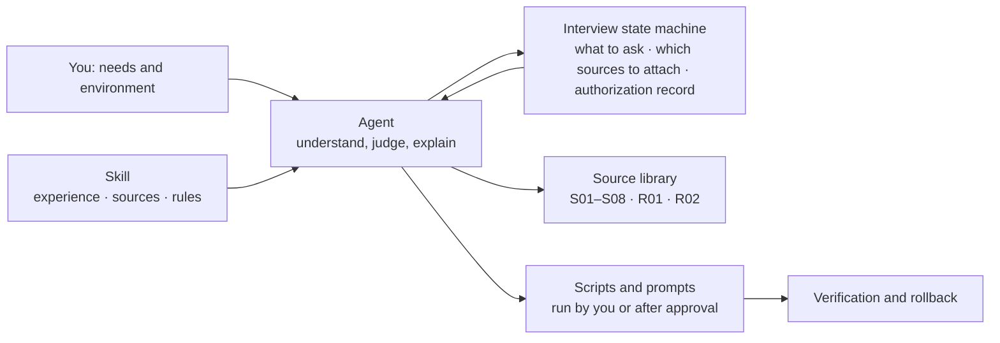

<div align="center">

# Claude-Guardian

**Your Agent, armed with real-world experience, helps you prepare, check and stabilize your Claude environment.**

Pre-subscription prep · Account signup and pacing · Fixed egress IP · Local / VM / VPS routes · Firewall and route optimization · Tiered authorization

[中文](README.md) · **English**

[What it does](#what-it-does) · [Ground rules](#ground-rules) · [How it works](#how-it-works) · [Tiered authorization](#tiered-authorization-you-dont-need-to-be-there-for-every-step) · [Quick start](#quick-start) · [Choosing a route](#choosing-a-route) · [Docs](#documentation)

[GPL-3.0-only](LICENSE) · [Changelog](CHANGELOG.md) · [Decision log](docs/decisions.md) · [Report an issue](https://github.com/DUNHKpcc/Claude-Guardian/issues)

</div>

---

Claude-Guardian is a Skill for Agents. It hands your Agent the author's and community's real experience, a curated source library and a set of scripts, so the Agent can walk you through preparing your subscription, account, network egress and runtime environment **according to your needs and setup**. Everyone's system, network, budget and goals differ, so it learns about you first and suggests what fits; high-risk steps are yours to decide.

> The Chinese [README.md](README.md) is the source text; where the two differ, the Chinese version wins. The source library under `skills/` is in Chinese.

## What it does

| | Capability | What it does |
| --- | --- | --- |
| 🧭 | **Route selection** | Helps you choose between local, virtual machine (VM) and remote server (VPS), explaining each route's scope, cost and who it suits |
| 🌐 | **Fixed egress IP** | Compares three sources (clean airport/proxy service, self-built proxy optionally with a residential exit, shared residential line) and their trade-offs; a short prompt for a self-built `3x-ui` + optimized-route VPS; 17 recommendation reports when picking a VPS |
| 📝 | **Signup and account pacing** | A recommended beginner combo (Apple in-app purchase + Gmail / Outlook + a clean personal VPS IP + VM or local machine + Pro: high refund success and stability); email signup, Gmail / Outlook / Proton, Free → Pro → Max intervals, quota use, education email; an anti-ban checklist for mobile (iOS / Android) |
| 💳 | **Subscription and payment** | Picks candidates from the "all AI payment methods" summary by your region, device and budget and explains the risks; you always pay yourself |
| 🖥️ | **VM route** | Guest OS (Omarchy / macOS), dedicated LAN NIC, build order, and a fail-closed `FlClash TUN` + `nftables` firewall script |
| ☁️ | **VPS route** | Use a VPS as the dev machine: Ubuntu 24.04, consistent environment, `Xvfb + noVNC` remote desktop, VS Code Remote-SSH, `tmux`, inbound firewall script |
| 💻 | **Local route** | Clash Verge / FlClash TUN and DNS setup, Windows firewall, LuLu on Mac, guided step by step with prompts |
| 🔒 | **Whole-machine uniform egress** | IPv4 only, no IPv6: strict TUN routing, DNS, fallback rules, and evidence checklists for leak and failure drills (Mac, Windows). `egress_verifier.py` rules `established / violated / incomplete` from the evidence you actually observed, without echoing the IP |
| 📈 | **Route optimization** | The Agent diagnoses and tunes the route item by item: SSH dynamic forwarding, Realm relay, BBR, each with a recorded original value and a rollback |
| 🩺 | **Failure triage** | `403` / `429` / `529`, billing conflicts, suspected credential leaks: pause retries, gather evidence, then propose the next step |
| 🧹 | **Cleanup planning** | Plans cleanup of Claude leftovers (Mac, Windows, Linux), moving conversation records only after asking you; after a ban, also clears proxy-client logs, VPN logs and IP-lookup commands in shell history; isolation (recoverable) is confirmed by you, nothing is permanently deleted, source code, Git history and Codex are left alone |
| 📚 | **Sources with every answer** | Each answer links its sources; beyond them it can search Linux.do, NodeSeek, IDC Flare, V2EX, Reddit and X, labelling source and date; also usable as a search tool for VPS, residential-IP, route and ban-experience posts |

## Ground rules

- **Money and accounts are yours:** you pay, sign up, log in, and do KYC and OAuth yourself.
- **No credentials needed:** you never hand over IPs, subscription links, passwords, UUIDs or full configs.
- **No Claude during prep:** the client is not started, logged into or contacted.
- **Adapted to your environment:** the author has used these tutorials and scripts on their own Mac, Windows, VM and VPS. Your system and app versions may differ, so the Agent checks first, adapts to the differences, and rolls back if something goes wrong.
- **Nobody can guarantee you won't be banned:** prices and access change fast; glance at the official pages before buying.

## How it works



- **Agent-led:** understands your needs, picks sources, explains results and decides the next step. The same Skill gives different people different approaches.
- **State machine as a backstop:** over a hundred interview questions are scheduled by condition; route-specific questions come only after you choose a route, and each assessment lists the sources to attach.
- **Scripts run as documented:** VM setup, firewall and similar scripts are run by you, or by the Agent once you approve.

## Tiered authorization: you don't need to be there for every step

Only the points that really matter need you. Changes fall into three tiers by risk; see [authorization tiers](skills/claude-guardian/references/authorization-tiers.md):

| Tier | What you do | Includes |
| --- | --- | --- |
| 🟢 **A: do within scope** | Confirm the scope once after route and goal are set | Read-only diagnosis, research, proposals, dry runs |
| 🟡 **B: approve the whole plan once** | Approve one plan; the Agent runs it continuously and undoes it on failure | Installing a client, adding allow rules, foreground forwarding, temporary BBR switch, installing TUN |
| 🔴 **C: confirm on the spot** | The Agent pauses at that step; reply whenever you see it | Default-outbound block, enabling a firewall, SSH changes, persistent kernel changes, data cleanup, accounts and money, credentials, organization devices, contacting Claude |

Approvals and confirmations come from your explicit reply in the conversation and are recorded in the interview state; a route change needs fresh confirmation.

## Quick start

### 1. Install the Skill

Copy the [`skills/claude-guardian`](skills/claude-guardian) folder from this repository into the Codex Skill directory you use, keeping its internal structure. Keep the root [LICENSE](LICENSE) when redistributing.

- Requires Codex with Skills support; scripts need **Python 3.10+**
- The Skill and references can be read directly; you can look things up without running any script
- The project never installs Python, proxy tools or background services by itself; some static YAML features need the optional PyYAML and stop with an explanation if it is missing

On macOS / Linux, run in Bash (skip `git clone` if you already have the repository):

```bash
git clone https://github.com/DUNHKpcc/Claude-Guardian.git
(
  set -eu
  skill_root="$HOME/.codex/skills"
  mkdir -p "$skill_root"
  if [ -e "$skill_root/claude-guardian" ] || [ -L "$skill_root/claude-guardian" ]; then
    printf '%s\n' 'Target exists; stopping. Inspect and back up the existing Skill, then migrate by hand.' >&2
    exit 1
  fi
  cp -R Claude-Guardian/skills/claude-guardian "$skill_root/claude-guardian"
)
```

You should end up with `~/.codex/skills/claude-guardian/SKILL.md`. The command stops on an existing target (including symlinks) to avoid nested copies or overwriting customizations; to update, inspect the diff, back up, and migrate the files you need by hand.

On Windows, download or clone the repository, create any missing parent directories in your Codex Skill directory (usually `%USERPROFILE%\.codex\skills`), and copy the whole `claude-guardian` folder there. Confirm the result is `skills\claude-guardian\SKILL.md`; if a same-named target exists, inspect, back up and migrate by hand rather than merging or overwriting.

### 2. Start a conversation in Codex

```text
$claude-guardian
I'm preparing my first Claude subscription, on a Mac. Compare local and VM first, then decide how to check.
```

The Agent asks about your stage, system and goal, without repeating questions you already answered; urgent failures and cleanup tasks go straight to their own flows.

### 3. Pick a route, then check

**Say what you want this time → choose local / VM / VPS → describe the network resources you have → confirm the check scope → check → approve the plan by tier**

If you only want to understand the subscription or compare options, stop at the explanation stage; your device is left untouched.

## Choosing a route

| Route | For | Main content |
| --- | --- | --- |
| **Local** `Clash Verge` `FlClash` `LuLu` `Windows Firewall` | Using your own Mac / Windows directly (the default suggestion) | Clash TUN and DNS, Windows firewall, LuLu on Mac; see [local Clash and firewall](skills/claude-guardian/references/local-firewall-prompts.md); egress IP sources in [egress sources](skills/claude-guardian/references/egress-ip-options.md) |
| **VM** `Omarchy` `macOS` `FlClash TUN` `nftables` | A separate working environment inside a virtual machine | Guest OS preferably Omarchy (macOS on a Mac host), dedicated LAN NIC, build order and fail-closed firewall scripts in the [VM guide](skills/claude-guardian/references/vm-guidance.md); reverse tunnel and crash self-healing for a target you cannot reach directly in the [advanced route](skills/claude-guardian/references/advanced-route.md) |
| **VPS** `Ubuntu 24.04` `Xvfb + noVNC` `Remote-SSH` `tmux` | A remote server as the dev machine (Claude Code runs on the VPS) | Consistent environment, remote desktop, firewall and route optimization in the [VPS guide](skills/claude-guardian/references/vps-guidance.md); once you buy a server and give SSH access, the Agent can deploy it under tiered authorization |

The three routes are parallel choices, not an upgrade path; using a VPS as a network exit is not the same as choosing the VPS route. No proxy or server yet? You can start with an offline pre-check. For the difference between an HTTP/mixed entry and an upstream SOCKS5 exit, see [environment entry and route boundaries](docs/environment-entry-decision.md).

Cleaning Claude data from an old device: macOS has a built-in host, see the [cleanup interface guide](skills/claude-guardian/references/cleanup-cli-usage.md); Windows uses a [PowerShell prompt](skills/claude-guardian/references/windows-cleanup.md) based on the official paths, Linux has its own [Linux cleanup](skills/claude-guardian/references/linux-cleanup.md). After a ban, proxy-client logs, VPN logs and IP-lookup commands in shell history are covered by [trace cleanup](skills/claude-guardian/references/trace-cleanup.md); jailbreak and reverse-proxy-distribution tools installed into Claude are removed per [illegal tools cleanup](skills/claude-guardian/references/illegal-tools-cleanup.md).

For the full rules see [contact and authorization boundaries](skills/claude-guardian/references/contact-and-safety.md) and the [network evidence notes](skills/claude-guardian/references/network-and-remedies.md).

## Examples

| What you want | What to say |
| --- | --- |
| Prepare a first subscription | "I'm on Windows and preparing my first subscription. Explain what needs confirming, then decide the route." |
| Local route, check the network | "I'm using this locally and the proxy config is imported. Help me confirm it is in effect." |
| Compare VM and VPS | "Compare these two routes. Don't check any device or deploy anything yet." |
| Handle an existing error | "Claude Code is erroring. Gather the existing evidence, then give the smallest fix." |

<details>
<summary><strong>For developers: command-line entry points</strong></summary>

Run these from the repository root. `interview_cli.py` is recommended for the full interview; `guardian.py interview` is a simplified compatible entry.

```sh
python3 skills/claude-guardian/scripts/guardian.py --help
python3 skills/claude-guardian/scripts/interview_cli.py --target-ref laptop-a --account-ref account-a
```

`laptop-a` and `account-a` are local aliases, not device or account identifiers. The interview prints the next question and stage assessment and does not save by default; use `--output` to save explicitly, and resume per the [interview notes](docs/interview-resume.md).

The target binding for `check` must come from the actual host and user confirmation; authorization cannot be fabricated. `analyze` / `plan` process local structured facts; see samples in [`tests/fixtures/`](tests/fixtures). Synthetic data must keep its synthetic marker, and importing a report does not restore execution permission. See the [inventory notes](docs/inventory-cli.md) for the full contract.

On Windows, use whichever Python 3 launcher is actually available, such as `py -3`. Platform support of each entry point follows its own help and docs; passing cross-platform core tests does not mean every host interface is available.

### CLI and script index

All paths are under `skills/claude-guardian/scripts/`; run commands from the repository root.

| Script | Purpose | Example |
| --- | --- | --- |
| `interview_cli.py` | Full interview, single-question scheduling and resume | `python3 skills/claude-guardian/scripts/interview_cli.py --target-ref laptop-a --account-ref account-a` |
| `guardian.py` | Simplified interview, local system and proxy-settings check, offline analysis and planning | `python3 skills/claude-guardian/scripts/guardian.py --help` |
| `network_check.py` | Basic network check: route, IPv4 exit, IPv6 blocked, DNS leak, UDP, failure drill (macOS, Windows, Linux) | `python3 skills/claude-guardian/scripts/network_check.py run --target-ref laptop-a` |
| `egress_verifier.py` | Whole-machine IPv4-only judgement | `python3 skills/claude-guardian/scripts/egress_verifier.py check --input evidence.json` |
| `status_dashboard.py` | Offline HTML dashboard from a report; `--network` adds the network check | `python3 skills/claude-guardian/scripts/status_dashboard.py --input report.json --network net.json --output dashboard.html` |
| `inventory_cli.py` | Capability query, gate status and static config audit | `python3 skills/claude-guardian/scripts/inventory_cli.py capabilities` |
| `agent_remediation.py` | Selects repair actions from a report | `python3 skills/claude-guardian/scripts/agent_remediation.py --help` |
| `repair_cli.py` | Exact-file precheck, plan, diff and execution; writes the `rules-prepend` extension of Clash Verge Rev 2.5.8 on Mac | `python3 skills/claude-guardian/scripts/repair_cli.py --help` |
| `recovery_cli.py` | Receipt-based check and exact-file restore (POSIX) | `python3 skills/claude-guardian/scripts/recovery_cli.py --help` |
| `cleanup_cli.py`, `native_cleanup_mac.py` | Claude local-data cleanup; built-in host on macOS | `python3 skills/claude-guardian/scripts/native_cleanup_mac.py --help` |
| `serve_webrtc.py` | Temporary loopback WebRTC test page | `python3 skills/claude-guardian/scripts/serve_webrtc.py --help` |

Output files (`--output`, `--evidence-output`, dashboard HTML) are always new files and never overwrite. Plans, receipts and restores for `repair_cli.py` and `recovery_cli.py` are in [offline recovery](docs/offline-recovery.md); the environment entry declaration is in [environment entry](docs/environment-entry-decision.md).

</details>

## Documentation

| Start here | Contents |
| --- | --- |
| [**Wiki**](https://github.com/DUNHKpcc/Claude-Guardian/wiki) | User-facing tutorials (generated from the repository; edit the repository, see `tools/export_wiki.py`) |
| [Skill entry](skills/claude-guardian/SKILL.md) | Conversation order, tool entries and on-demand loading rules |
| [Local, VM and VPS](skills/claude-guardian/references/routes-and-platforms.md) | Route choice, target boundaries and lifecycle |
| [Accounts and payment prep](skills/claude-guardian/references/accounts-and-payments.md) | Subscription stage, channel prerequisites and payment handoff |
| [Account signup and pacing](skills/claude-guardian/references/account-onboarding.md) | Email, Free→Pro→Max intervals, quota and education email |
| [Mobile anti-ban notes](skills/claude-guardian/references/mobile-guidance.md) | iOS / Android checklist, removing the SIM on Android |
| [Ban appeal](skills/claude-guardian/references/ban-appeal.md) | Appeal template, 2–7 day reply window, use after reinstatement |
| [Fixed egress IP sources](skills/claude-guardian/references/egress-ip-options.md) | Airport, self-built proxy, shared residential; recommendations and the short self-build prompt |
| [Local Clash and firewall](skills/claude-guardian/references/local-firewall-prompts.md) | Windows firewall, LuLu on Mac, prompt-guided |
| [VM guide](skills/claude-guardian/references/vm-guidance.md) | Guest OS, dedicated LAN NIC, build order, fail-closed firewall |
| [VPS guide](skills/claude-guardian/references/vps-guidance.md) | Dev machine, consistent environment, remote desktop, firewall |
| [Route optimization](skills/claude-guardian/references/line-optimization.md) | Item-by-item diagnosis and tuning, change cards and rollback |
| [Network and remedies](skills/claude-guardian/references/network-and-remedies.md) | Interpreting evidence for proxy, DNS, IPv4/IPv6, UDP/WebRTC |
| [Environment dashboard](docs/environment-dashboard.md) | Build an offline page from an existing report, no new check |
| [Rules extension candidate](docs/rules-extension-plan.md) | Private diff, input binding and current execution limits |
| [Incidents and cleanup](skills/claude-guardian/references/incidents-and-integrations.md) | Failures, retained scope, appeals and integration boundaries |
| [Source library](skills/claude-guardian/references/source-library.md) | Bundled originals, sections and sources by topic |

Source originals keep their own attribution and license, and related answers cite them.

## Development and verification

```sh
python3 -m unittest discover -s tests -v
python3 -m compileall -q skills/claude-guardian/scripts
python3 tools/package_skill.py --help
```

When packaging, use `--output` for a new ZIP path in your own temporary directory; tests use synthetic data only. CI runs unit, regression and deterministic packaging checks on Linux, macOS and Windows. What changed is in the [CHANGELOG](CHANGELOG.md); why is in the [decision log](docs/decisions.md).

**Real-device verification and feedback:** the author verified these tutorials and scripts on their own Mac, Windows, VM and VPS, and the Clash Verge write and rollback and the whole-machine egress ruling on Mac went through item-by-item real-device acceptance (see [ADR-039](docs/decisions.md)). Tell us which item you used, how it went and what needed adjusting through the [device report](https://github.com/DUNHKpcc/Claude-Guardian/issues/new?template=device-report.yml).

## Star History

[](https://www.star-history.com/?repos=DUNHKpcc%2FClaude-Guardian&type=date)

## Community channels

- Telegram channel: [https://t.me/+q4D4_Qf_FIs5NDk1](https://t.me/+q4D4_Qf_FIs5NDk1)
- QQ: 1048450370

Swap experience and share usage in the channel; for problem reports and suggestions use Issues so they are on record.

## Feedback and license

Report problems through [Issues](https://github.com/DUNHKpcc/Claude-Guardian/issues), or submit docs, synthetic samples and regression tests. Include your system, version, reproduction steps and expected result, and keep accounts, credentials, subscription links and full proxy configs out of it.

Code is licensed **[GPL-3.0-only](LICENSE)**. Source originals keep their existing attribution and license notices.
