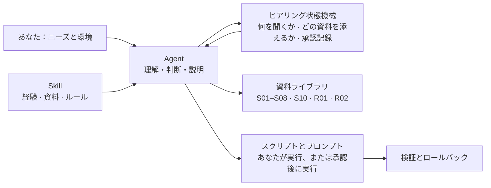

<div align="center">

# Claude-Guardian

**実体験を携えた Agent が、Claude の利用環境の準備・確認・安定化を手伝います。**

サブスクリプション前の準備 · アカウント登録と利用ペース · 固定出口 IP · ローカル / VM / VPS ルート · ファイアウォールと回線最適化 · 段階的な承認

<p>
  <a href="https://trendshift.io/repositories/315286?utm_source=trendshift-badge&amp;utm_medium=badge&amp;utm_campaign=badge-trendshift-315286" target="_blank" rel="noopener noreferrer"></a>
  <a href="https://trendshift.io/repositories/315286?utm_source=trendshift-badge&amp;utm_medium=badge&amp;utm_campaign=badge-trendshift-315286" target="_blank" rel="noopener noreferrer"></a>
</p>

[中文](README.md) · [English](README.en.md) · **日本語**

[できること](#できること) · [基本原則](#基本原則) · [仕組み](#仕組み) · [段階的な承認](#段階的な承認) · [クイックスタート](#クイックスタート) · [ルートの選び方](#ルートの選び方) · [ドキュメント](#ドキュメント)

[GPL-3.0-only](LICENSE) · [変更履歴](CHANGELOG.md) · [決定記録](docs/decisions.md) · [問題を報告](https://github.com/DUNHKpcc/Claude-Guardian/issues)

</div>

---

Claude-Guardian は Agent 向けの Skill です。作者とコミュニティの実体験、厳選した資料ライブラリ、スクリプト一式を Agent に渡し、**あなたのニーズと環境に合わせて**、サブスクリプション・アカウント・ネットワークの出口・実行環境の準備を Agent が案内できるようにします。システム、ネットワーク、予算、目的は人それぞれなので、まずあなたのことを把握してから合った方法を提案します。リスクの高い手順はあなたが判断します。

> 原文は中国語の [README.md](README.md) です。内容が異なる場合は中国語版が優先されます。`skills/` 以下の資料ライブラリは中国語です。

## パートナー

<table align="center">
  <tr>
    <td align="center">
      <a href="https://api.dpccgaming.xyz"></a>
      <br />
      自分で設定したくない場合は DPCC API をお試しください。画像をクリックしてください。
    </td>
    <td align="center">
      <a href="https://api.dpccgaming.xyz/guardian"></a>
      <br />
      自分で設定したくない場合は、設定代行サービスと Skill ウェブサイトはこちら。画像をクリックしてください。
    </td>
  </tr>
</table>

## できること

| | 機能 | 内容 |
| --- | --- | --- |
| 🧭 | **ルート選択** | ローカル、仮想マシン（VM）、リモートサーバー（VPS）から選ぶのを手伝い、各ルートの範囲・コスト・向いている人を説明します |
| 🌐 | **固定出口 IP** | 3 つの入手元（クリーンなプロキシサービス「机场」、自前構築のプロキシ（住宅 IP 出口も可）、共有住宅回線）とそれぞれのトレードオフを比較します。`3x-ui` と最適化回線 VPS を自前構築するための短いプロンプト、VPS 選びの際の推奨レポート 17 本を用意しています |
| 📝 | **登録とアカウントの利用ペース** | 初心者向けの推奨構成（Apple アプリ内課金 + Gmail / Outlook + クリーンな個人 VPS IP + VM またはローカルマシン + Pro：返金成功率が高く安定）。メール登録、Gmail / Outlook / Proton、Free → Pro → Max の間隔、利用枠の使い方、教育機関メール。モバイル（iOS / Android）向けの BAN 対策チェックリスト |
| 💳 | **サブスクリプションと支払い** | 「AI 支払い方法まとめ」から地域・デバイス・予算に合った候補を選び、リスクを説明します。支払いは必ずご自身で行います |
| 🖥️ | **VM ルート** | ゲスト OS（Omarchy / macOS）、専用 LAN NIC、構築手順、fail-closed な `FlClash TUN` + `nftables` ファイアウォールスクリプト |
| ☁️ | **VPS ルート** | VPS を開発マシンとして使用：Ubuntu 24.04、一貫した環境、`Xvfb + noVNC` リモートデスクトップ、VS Code Remote-SSH、`tmux`、受信ファイアウォールスクリプト |
| 💻 | **ローカルルート** | Clash Verge / FlClash の TUN と DNS 設定、プロンプトで段階的に案内する Windows ファイアウォール、Mac の PF スクリプト（[受け入れ済みの範囲](skills/claude-guardian/references/local-firewall-prompts.md#mac)） |
| 🔒 | **マシン全体の出口統一** | IPv4 のみ、IPv6 なし：厳格な TUN ルーティング、DNS、フォールバックルール、漏洩・障害訓練のための証拠チェックリスト（Mac、Windows）。`egress_verifier.py` が実際に観測した証拠から `established / violated / incomplete` を判定し、IP は表示しません |
| 📈 | **回線最適化** | Agent が回線を項目ごとに診断・調整します：SSH ダイナミックフォワーディング、Realm リレー、BBR。いずれも元の値を記録し、ロールバックできます |
| 🩺 | **障害の切り分け** | `403` / `429` / `529`、請求の競合、認証情報の漏洩が疑われる場合：再試行を止め、証拠を集めてから次の手順を提案します |
| 🧹 | **クリーンアップ計画** | Claude の残存データ（Mac、Windows、Linux）のクリーンアップを計画し、会話記録はあなたに確認してから移動します。BAN 後はプロキシクライアントのログ、VPN ログ、シェル履歴内の IP 確認コマンドも削除します。隔離（復元可能）はあなたが確認し、完全削除は行いません。ソースコード、Git 履歴、Codex には手を付けません |
| 📚 | **すべての回答に出典** | 各回答に出典へのリンクを付けます。それ以外にも Linux.do、NodeSeek、IDC Flare、V2EX、Reddit、X を検索でき、出典と日付を明記します。VPS、住宅 IP、回線、BAN 体験に関する投稿の検索ツールとしても使えます |

## 基本原則

- **お金とアカウントはあなたのもの：** 支払い、登録、ログイン、KYC、OAuth はご自身で行います。
- **認証情報は不要：** IP、サブスクリプションリンク、パスワード、UUID、設定全体を渡す必要はありません。
- **準備中は Claude に触れない：** クライアントの起動、ログイン、接続は行いません。
- **あなたの環境に合わせる：** 作者はこれらのチュートリアルとスクリプトを自身の Mac、Windows、VM、VPS で使用してきました。あなたのシステムやアプリのバージョンは異なる場合があるため、Agent がまず確認し、差異に合わせて調整し、問題があればロールバックします。
- **BAN されないことは誰にも保証できません：** 価格や利用条件はすぐに変わります。購入前に公式ページを確認してください。

## 仕組み



- **Agent 主導：** ニーズを理解し、資料を選び、結果を説明し、次の手順を決めます。同じ Skill でも人によって異なるアプローチになります。
- **状態機械が下支え：** 100 以上のヒアリング質問が条件に応じてスケジュールされます。ルート固有の質問はルートを選んだ後にのみ出され、各評価には添付すべき資料が列挙されます。
- **スクリプトは記載どおりに実行：** VM 設定やファイアウォールなどのスクリプトは、あなたが実行するか、あなたの承認後に Agent が実行します。

## 段階的な承認

毎ステップに立ち会う必要はありません。本当に重要な箇所だけあなたの判断が必要です。変更はリスクに応じて 3 段階に分かれます。詳しくは[承認の段階](skills/claude-guardian/references/authorization-tiers.md)を参照してください。

| 段階 | あなたがすること | 対象 |
| --- | --- | --- |
| 🟢 **A：範囲内で実行** | ルートと目的が決まった後、範囲を一度確認 | 読み取り専用の診断、調査、提案、ドライラン |
| 🟡 **B：計画全体を一度承認** | 計画を一度承認すると、Agent が連続して実行し、失敗時は元に戻します | クライアントのインストール、許可ルールの追加、フォアグラウンドのフォワーディング、一時的な BBR 切り替え、TUN のインストール |
| 🔴 **C：その場で確認** | Agent がその手順で一時停止します。気づいたときに返信してください | デフォルト送信のブロック、ファイアウォールの有効化、SSH の変更、永続的なカーネル変更、データのクリーンアップ、アカウントとお金、認証情報、組織のデバイス、Claude への接続 |

承認と確認は会話内でのあなたの明示的な返信によって行われ、ヒアリング状態に記録されます。ルートを変更した場合は改めて確認が必要です。

## クイックスタート

### 1. Skill をインストール

このリポジトリの [`skills/claude-guardian`](skills/claude-guardian) フォルダを、内部構造を保ったまま、使用している Codex の Skill ディレクトリにコピーします。再配布する場合はルートの [LICENSE](LICENSE) を同梱してください。

- Skills に対応した Codex が必要です。スクリプトには **Python 3.10+** が必要です
- Skill と参考資料はそのまま読めます。スクリプトを実行しなくても調べられます
- このプロジェクトが Python、プロキシツール、バックグラウンドサービスを勝手にインストールすることはありません。一部の静的 YAML 機能にはオプションの PyYAML が必要で、未インストールの場合は説明を表示して停止します

macOS / Linux では Bash で実行します（リポジトリが既にある場合は `git clone` を省略）：

```bash
git clone https://github.com/DUNHKpcc/Claude-Guardian.git
(
  set -eu
  skill_root="$HOME/.codex/skills"
  mkdir -p "$skill_root"
  if [ -e "$skill_root/claude-guardian" ] || [ -L "$skill_root/claude-guardian" ]; then
    printf '%s\n' 'Target exists; stopping. Inspect and back up the existing Skill, then migrate by hand.' >&2
    exit 1
  fi
  cp -R Claude-Guardian/skills/claude-guardian "$skill_root/claude-guardian"
)
```

最終的に `~/.codex/skills/claude-guardian/SKILL.md` ができていれば完了です。コピー先が既に存在する場合（シンボリックリンクを含む）、入れ子のコピーやカスタマイズの上書きを避けるためコマンドは停止します。更新する場合は差分を確認し、バックアップを取ってから、必要なファイルを手動で移行してください。

**更新：** 各セッションの開始時に、Agent が `scripts/update_check.py check`（読み取り専用、GitHub にのみ接続）を実行し、すべてのファイルをリポジトリの main ブランチと比較して、最近の変更内容を伝えます。あなたの承認があれば、現在の Skill を Skill ディレクトリ外にバックアップし、あなた自身が変更したファイルを保持したまま新しいバージョンに切り替えます。詳しくは [Skill の更新](skills/claude-guardian/references/skill-update.md)を参照してください。

Windows では、リポジトリをダウンロードまたはクローンし、Codex の Skill ディレクトリ（通常は `%USERPROFILE%\.codex\skills`）に足りない親ディレクトリを作成してから、`claude-guardian` フォルダ全体をそこにコピーします。結果が `skills\claude-guardian\SKILL.md` になっていることを確認してください。同名のコピー先が存在する場合は、マージや上書きをせず、確認・バックアップしてから手動で移行してください。

### 2. Codex で会話を始める

```text
$claude-guardian
初めて Claude のサブスクリプションを準備しています。Mac を使っています。まずローカルと VM を比較してから、どう確認するか決めてください。
```

Agent があなたの段階、システム、目的を尋ねます。既に答えた質問は繰り返しません。緊急の障害やクリーンアップ作業は、それぞれ専用のフローに直接進みます。

### 3. ルートを選んで確認する

**今回やりたいことを伝える → ローカル / VM / VPS を選ぶ → 手持ちのネットワーク資源を説明する → 確認範囲を承認する → 確認 → 段階に応じて計画を承認する**

サブスクリプションを理解したい、または選択肢を比較したいだけなら、説明の段階で止めてかまいません。デバイスには一切手を加えません。

## ルートの選び方

**対象のマシンに既に Agent がある場合は、そのマシン上で直接作業してください。** OpenSSH、Tailscale、NAT 越え、リモートでの障害訓練は、オプションの[リモート支援向けローカルルート拡張](skills/claude-guardian/references/local-advanced-route.md)に含まれます。ローカルルートの前提条件ではありません。

| ルート | 用途 | 主な内容 |
| --- | --- | --- |
| **ローカル** `Clash Verge` `FlClash` `macOS PF` `Windows Firewall` | 自分の Mac / Windows を直接使う（デフォルトの提案） | Clash の TUN と DNS、Windows ファイアウォール、Mac の PF。[ローカル Clash とファイアウォール](skills/claude-guardian/references/local-firewall-prompts.md)を参照。出口 IP の入手元は[出口の入手元](skills/claude-guardian/references/egress-ip-options.md)を参照 |
| **VM** `Omarchy` `macOS` `FlClash TUN` `nftables` | 仮想マシン内に独立した作業環境を作る | ゲスト OS は Omarchy 推奨（Mac ホストでは macOS）、専用 LAN NIC、構築手順、fail-closed なファイアウォールスクリプトは [VM ガイド](skills/claude-guardian/references/vm-guidance.md)に。直接到達できない対象向けのリバーストンネルとクラッシュ時の自己修復は[上級ルート](skills/claude-guardian/references/advanced-route.md)に |
| **VPS** `Ubuntu 24.04` `Xvfb + noVNC` `Remote-SSH` `tmux` | リモートサーバーを開発マシンにする（Claude Code は VPS 上で実行） | 一貫した環境、リモートデスクトップ、ファイアウォール、回線最適化は [VPS ガイド](skills/claude-guardian/references/vps-guidance.md)に。サーバーを購入して SSH アクセスを渡せば、Agent が段階的な承認のもとでデプロイできます |

3 つのルートは並列の選択肢であり、段階的なアップグレードではありません。VPS をネットワークの出口として使うことは、VPS ルートを選ぶことと同じではありません。プロキシやサーバーがまだない場合は、オフラインの事前確認から始められます。HTTP/mixed 入口と上流 SOCKS5 出口の違いについては、[環境の入口とルートの境界](docs/environment-entry-decision.md)を参照してください。

古いデバイスから Claude のデータを削除する場合：macOS には組み込みのホストがあります。[クリーンアップインターフェースガイド](skills/claude-guardian/references/cleanup-cli-usage.md)を参照してください。Windows では公式パスに基づく [PowerShell プロンプト](skills/claude-guardian/references/windows-cleanup.md)を使用し、Linux には専用の [Linux クリーンアップ](skills/claude-guardian/references/linux-cleanup.md)があります。BAN 後のプロキシクライアントのログ、VPN ログ、シェル履歴内の IP 確認コマンドは[痕跡クリーンアップ](skills/claude-guardian/references/trace-cleanup.md)で扱います。Claude に導入された脱獄ツールやリバースプロキシ配布ツールは[違法ツールのクリーンアップ](skills/claude-guardian/references/illegal-tools-cleanup.md)に従って削除します。

ルール全体については[接触と承認の境界](skills/claude-guardian/references/contact-and-safety.md)と[ネットワーク証拠に関するメモ](skills/claude-guardian/references/network-and-remedies.md)を参照してください。

## 使用例

| やりたいこと | 伝え方 |
| --- | --- |
| 初めてのサブスクリプションを準備 | 「Windows を使っていて、初めてのサブスクリプションを準備しています。確認が必要なことを説明してから、ルートを決めてください。」 |
| ローカルルートでネットワークを確認 | 「ローカルで使っていて、プロキシ設定はインポート済みです。有効になっているか確認を手伝ってください。」 |
| VM と VPS を比較 | 「この 2 つのルートを比較してください。まだデバイスの確認やデプロイはしないでください。」 |
| 既存のエラーに対処 | 「Claude Code でエラーが出ています。既存の証拠を集めてから、最小限の修正を提示してください。」 |

<details>
<summary><strong>開発者向け：コマンドラインのエントリポイント</strong></summary>

リポジトリのルートから実行します。完全なヒアリングには `interview_cli.py` を推奨します。`guardian.py interview` は簡易版の互換エントリです。

```sh
python3 skills/claude-guardian/scripts/guardian.py --help
python3 skills/claude-guardian/scripts/interview_cli.py --target-ref laptop-a --account-ref account-a
```

`laptop-a` と `account-a` はローカルの別名であり、デバイスやアカウントの識別子ではありません。ヒアリングは次の質問と段階の評価を表示し、デフォルトでは保存しません。明示的に保存するには `--output` を使い、[ヒアリングに関するメモ](docs/interview-resume.md)に従って再開してください。

`check` の対象バインディングは、実際のホストとユーザーの確認から得る必要があり、承認を偽造することはできません。`analyze` / `plan` はローカルの構造化された事実を処理します。サンプルは [`tests/fixtures/`](tests/fixtures) を参照してください。合成データには合成であることを示すマーカーを残す必要があり、レポートをインポートしても実行権限は復元されません。完全な仕様は[インベントリに関するメモ](docs/inventory-cli.md)を参照してください。

Windows では、`py -3` など実際に利用できる Python 3 ランチャーを使ってください。各エントリポイントのプラットフォーム対応は、それぞれのヘルプとドキュメントに従います。クロスプラットフォームのコアテストに通ったからといって、すべてのホストインターフェースが使えるとは限りません。

### CLI とスクリプトの一覧

パスはすべて `skills/claude-guardian/scripts/` 以下です。コマンドはリポジトリのルートから実行してください。

| スクリプト | 用途 | 例 |
| --- | --- | --- |
| `interview_cli.py` | 完全なヒアリング、1 問ずつのスケジューリングと再開 | `python3 skills/claude-guardian/scripts/interview_cli.py --target-ref laptop-a --account-ref account-a` |
| `guardian.py` | 簡易ヒアリング、ローカルシステムとプロキシ設定の確認、オフライン分析と計画 | `python3 skills/claude-guardian/scripts/guardian.py --help` |
| `network_check.py` | 基本的なネットワーク確認：ルート、IPv4 出口、IPv6 遮断、DNS 漏洩、UDP、障害訓練（macOS、Windows、Linux） | `python3 skills/claude-guardian/scripts/network_check.py run --target-ref laptop-a` |
| `egress_verifier.py` | マシン全体の IPv4 のみ判定 | `python3 skills/claude-guardian/scripts/egress_verifier.py check --input evidence.json` |
| `status_dashboard.py` | レポートからオフライン HTML ダッシュボードを生成。`--network` でネットワーク確認を追加 | `python3 skills/claude-guardian/scripts/status_dashboard.py --input report.json --network net.json --output dashboard.html` |
| `inventory_cli.py` | 機能照会、ゲートの状態、静的な設定監査 | `python3 skills/claude-guardian/scripts/inventory_cli.py capabilities` |
| `agent_remediation.py` | レポートから修復アクションを選択 | `python3 skills/claude-guardian/scripts/agent_remediation.py --help` |
| `repair_cli.py` | 正確なファイル単位の事前確認、計画、差分、実行。Mac では Clash Verge Rev 2.5.8 の `rules-prepend` 拡張を書き込みます | `python3 skills/claude-guardian/scripts/repair_cli.py --help` |
| `recovery_cli.py` | レシートに基づく確認と正確なファイル単位の復元（POSIX） | `python3 skills/claude-guardian/scripts/recovery_cli.py --help` |
| `cleanup_cli.py`、`native_cleanup_mac.py` | Claude のローカルデータのクリーンアップ。macOS では組み込みホスト | `python3 skills/claude-guardian/scripts/native_cleanup_mac.py --help` |
| `serve_webrtc.py` | 一時的なループバック WebRTC テストページ | `python3 skills/claude-guardian/scripts/serve_webrtc.py --help` |

出力ファイル（`--output`、`--evidence-output`、ダッシュボード HTML）は常に新規ファイルとして作成され、上書きされることはありません。`repair_cli.py` と `recovery_cli.py` の計画、レシート、復元については[オフライン復旧](docs/offline-recovery.md)を、環境の入口の宣言については[環境の入口](docs/environment-entry-decision.md)を参照してください。

</details>

## ドキュメント

| まずはここから | 内容 |
| --- | --- |
| [**Wiki**](https://github.com/DUNHKpcc/Claude-Guardian/wiki) | ユーザー向けチュートリアル（リポジトリから生成。編集はリポジトリで行います。`tools/export_wiki.py` を参照） |
| [Skill のエントリ](skills/claude-guardian/SKILL.md) | 会話の順序、ツールのエントリ、オンデマンド読み込みのルール |
| [ローカル、VM、VPS](skills/claude-guardian/references/routes-and-platforms.md) | ルートの選択、対象の境界、ライフサイクル |
| [アカウントと支払いの準備](skills/claude-guardian/references/accounts-and-payments.md) | サブスクリプションの段階、チャネルの前提条件、支払いの引き継ぎ |
| [アカウント登録と利用ペース](skills/claude-guardian/references/account-onboarding.md) | メール、Free→Pro→Max の間隔、利用枠、教育機関メール |
| [モバイルの BAN 対策メモ](skills/claude-guardian/references/mobile-guidance.md) | iOS / Android のチェックリスト、Android での SIM の取り外し |
| [BAN の異議申し立て](skills/claude-guardian/references/ban-appeal.md) | 申し立てテンプレート、2〜7 日の返信期間、復旧後の使い方 |
| [固定出口 IP の入手元](skills/claude-guardian/references/egress-ip-options.md) | 机场、自前構築のプロキシ、共有住宅回線。推奨と自前構築用の短いプロンプト |
| [ローカル Clash とファイアウォール](skills/claude-guardian/references/local-firewall-prompts.md) | Windows ファイアウォール（プロンプトで案内）、Mac の PF スクリプト |
| [VM ガイド](skills/claude-guardian/references/vm-guidance.md) | ゲスト OS、専用 LAN NIC、構築手順、fail-closed なファイアウォール |
| [VPS ガイド](skills/claude-guardian/references/vps-guidance.md) | 開発マシン、一貫した環境、リモートデスクトップ、ファイアウォール |
| [回線最適化](skills/claude-guardian/references/line-optimization.md) | 項目ごとの診断と調整、変更カードとロールバック |
| [ネットワークと対処法](skills/claude-guardian/references/network-and-remedies.md) | プロキシ、DNS、IPv4/IPv6、UDP/WebRTC の証拠の読み方 |
| [環境ダッシュボード](docs/environment-dashboard.md) | 既存のレポートからオフラインページを作成（新たな確認は行いません） |
| [ルール拡張の候補](docs/rules-extension-plan.md) | 非公開の差分、入力のバインディング、現在の実行上の制限 |
| [インシデントとクリーンアップ](skills/claude-guardian/references/incidents-and-integrations.md) | 障害、保持範囲、異議申し立て、連携の境界 |
| [資料ライブラリ](skills/claude-guardian/references/source-library.md) | 同梱の原文、セクション、トピック別の出典 |

資料の原文はそれぞれの帰属表示とライセンスを保持しており、関連する回答ではそれらを引用します。

## 開発と検証

```sh
python3 -m unittest discover -s tests -v
python3 -m compileall -q skills/claude-guardian/scripts
python3 tools/package_skill.py --help
```

パッケージングの際は、`--output` で自分の一時ディレクトリ内の新しい ZIP パスを指定してください。テストでは合成データのみを使用します。CI は Linux、macOS、Windows で単体テスト、回帰テスト、決定的なパッケージングの確認を実行します。何が変わったかは [CHANGELOG](CHANGELOG.md) に、なぜ変わったかは[決定記録](docs/decisions.md)にあります。

**実機での検証とフィードバック：** 作者はこれらのチュートリアルとスクリプトを自身の Mac、Windows、VM、VPS で検証しており、Mac での Clash Verge の書き込みとロールバック、およびマシン全体の出口判定は項目ごとの実機受け入れテストを経ています（[ADR-039](docs/decisions.md) を参照）。どの項目を使い、どうだったか、何を調整する必要があったかを[デバイスレポート](https://github.com/DUNHKpcc/Claude-Guardian/issues/new?template=device-report.yml)でお知らせください。

## Star History

[](https://www.star-history.com/?repos=DUNHKpcc%2FClaude-Guardian&type=date)

## コミュニティチャンネル

- Telegram チャンネル：[https://t.me/+q4D4_Qf_FIs5NDk1](https://t.me/+q4D4_Qf_FIs5NDk1)
- QQ：1048450370

チャンネルでは経験の交換や使い方の共有ができます。問題の報告や提案は記録に残るよう Issues をご利用ください。

## フィードバックとライセンス

問題は [Issues](https://github.com/DUNHKpcc/Claude-Guardian/issues) で報告するか、ドキュメント、合成サンプル、回帰テストを提出してください。システム、バージョン、再現手順、期待される結果を記載し、アカウント、認証情報、サブスクリプションリンク、プロキシ設定全体は含めないでください。

コードのライセンスは **[GPL-3.0-only](LICENSE)** です。資料の原文は既存の帰属表示とライセンス表記を保持します。
