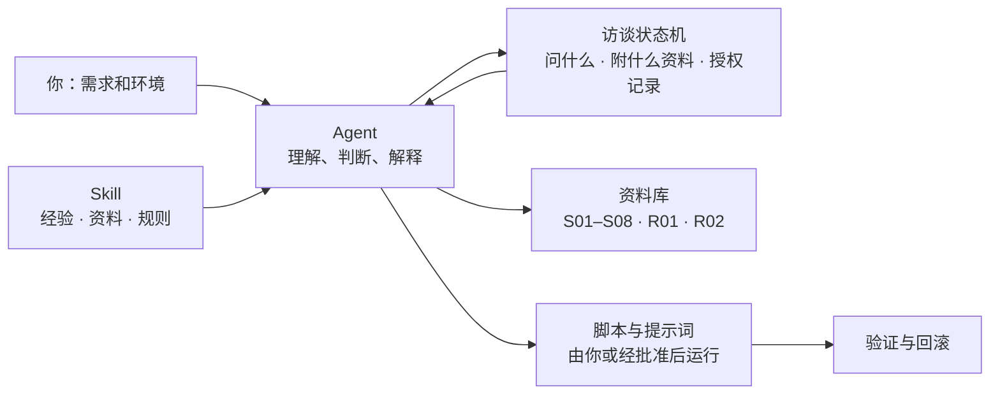

<div align="center">

# Claude-Guardian


**Agent带着真实经验，陪你把 Claude 的使用环境准备好、查清楚、用着不烧心。不要碰代过kyc(定制除外) 成品号 代充 成品邮箱 !!!**

订阅前准备 · 账号注册与使用节奏 · 固定出口 IP · 本机 / VM / VPS 三条路线 · 防火墙与线路优化 · 分级授权

<p>
  <b>平台</b>
  
  
  
  
</p>

<p>
  <b>网络与代理</b>
  
  
  
  
  
  
  
  
  
</p>

**中文** · [English](README.en.md)

[它能干什么](#它能干什么) · [几条底线](#几条底线) · [怎么工作](#怎么工作) · [分级授权](#分级授权你不需要每一步都在场) · [快速开始](#快速开始) · [选择运行路线](#选择运行路线) · [文档导航](#文档导航)

[GPL-3.0-only](LICENSE) · [更新记录](CHANGELOG.md) · [决策记录](docs/decisions.md) · [反馈问题](https://github.com/DUNHKpcc/Claude-Guardian/issues) · [LINUX DO](https://linux.do)

</div>

---

Claude-Guardian 是一个给 Agent 用的 Skill。它把作者和社区的真实经验、整理好的资料和一批脚本交给 Agent，让 Agent **按你的需求和环境**，陪你一步步把订阅、账号、网络出口和运行环境准备好。每个人的系统、网络、预算和目标都不一样，所以它先了解你，再给适合你的做法；风险高的步骤由你拍板。

## Partners

<table align="center">
  <tr>
    <td align="center">
      <a href="https://api.dpccgaming.xyz"></a>
      <br />
      懒得自己配环境？试试 DPCC API，满血Claude，点击图片即可跳转
    </td>
    <td align="center">
      <a href="https://api.dpccgaming.xyz/guardian"></a>
      <br />
      不想自己搭？可以找人代搭建，Skill 官网也在这里，点击图片即可跳转
    </td>
  </tr>
</table>

## 它能干什么

| | 能力 | 具体做什么 |
| --- | --- | --- |
| 🧭 | **选路线** | 帮你在本机、虚拟机（VM）、远程服务器（VPS）之间选，说清每条路线的范围、代价和适合谁 |
| 🌐 | **固定出口 IP** | 介绍纯净机场、自建梯（可搭配家宽出口）、家宽拼车三种来源及优缺点；自建梯给 `3x-ui` + 优化线路 VPS 的简版提示；选 VPS 时附 17 份推荐报告 |
| 📝 | **注册与养号节奏** | 新手试错推荐组合（苹果内购 + Gmail／Outlook + VPS 纯净个人 IP + VM 或本机 + Pro，退款成功率高、稳定率高）；邮箱注册、Gmail / Outlook / Proton、Free → Pro → Max 的间隔、额度使用、并发、教育邮箱；手机端（iOS / Android）防封检查表 |
| 💳 | **订阅与支付** | 按你的地区、设备、预算，从《AI 所有支付方式汇总》里挑候选并说明风险；付款始终由你本人完成 |
| 🖥️ | **VM 路线** | 客机系统（Omarchy / macOS）、LAN 独立网卡、搭建顺序，以及 `FlClash TUN` + `nftables` 的 fail-closed 防火墙脚本 |
| ☁️ | **VPS 路线** | 把 VPS 当开发机：Ubuntu 24.04、环境一致、`Xvfb + noVNC` 远程桌面、VS Code Remote-SSH、`tmux`、入站防火墙脚本 |
| 💻 | **本机路线** | Clash Verge / FlClash 的 TUN 与 DNS 引导，Windows 系统防火墙、Mac 的 LuLu，用提示词一步步带你配 |
| 🔒 | **整机统一出口** | 整机只走 IPv4、不走 IPv6：`TUN` 严格路由、DNS、规则兜底、泄漏与故障演练的取证清单（Mac、Windows），`egress_verifier.py` 按你实际观察到的证据判定 `established / violated / incomplete`，不回显 IP |
| 📈 | **线路优化** | Agent 逐项诊断并优化线路：SSH 动态转发、Realm 中转、BBR，每项都有原值记录和回滚 |
| 🩺 | **故障分流** | `403` / `429` / `529`、账单冲突、疑似凭据泄露：先暂停重试、整理证据，再给下一步 |
| 🧹 | **清理规划** | 规划旧设备 Claude 残留的清理（Mac、Windows、Linux），对话记录问过你再移走；封号后换环境时一并清代理客户端日志、VPN 日志和终端历史里查 IP 的命令；隔离（可恢复）由你确认，不永久删除，源码、Git 历史和 Codex 不动 |
| 📚 | **资料随答附带** | 每个回答附上对应来源链接；资料之外需要补充时，可到 Linux.do、NodeSeek、IDC Flare、V2EX、Reddit、X 查找并标明来源和日期；也可直接当 VPS、家宽、线路、封号经验的帖子与论坛搜索工具用 |

## 几条底线

- **钱和账号你来：**付款、注册、登录、KYC、OAuth 都由你本人完成。
- **不要你的凭据：**不用交出 IP、订阅链接、密码、UUID 或完整配置。
- **准备阶段不碰 Claude：**不启动客户端、不登录、不访问其服务。
- **按你的环境调整：**这些教程和脚本作者在自己的 Mac、Windows、VM 和 VPS 上都用过。你的系统和应用版本可能不同，Agent 会先核对、按差异调整，出问题就回滚。
- **没人能保证免封：**价格和准入变化快，购买前看一眼官方页面。

## 怎么工作



- **Agent 主导：**理解你的需求，挑资料，解释结果，决定下一步。同一个 Skill 对不同的人给出不同的做法。
- **状态机兜底：**上百个访谈问题按条件调度，选定路线后才问路线相关的问题；每次评估都列出要附上的资料。
- **脚本照文档跑：**VM 搭建、防火墙等脚本由你运行，或经你批准后由 Agent 运行。

## 分级授权：你不需要每一步都在场

只有真正重要的点才需要你。改动按风险分三档，详见[分级授权](skills/claude-guardian/references/authorization-tiers.md)：

| 档位 | 你要做什么 | 包含什么 |
| --- | --- | --- |
| 🟢 **A 范围内自行做** | 路线和目标确定后，确认一次范围 | 只读诊断、查资料、出方案、预演 |
| 🟡 **B 整个计划批准一次** | 批准一张计划，Agent 连续执行，失败自动撤销 | 装客户端、加允许规则、前台转发、临时切 BBR、装 TUN |
| 🔴 **C 必须当场确认** | 到这一步 Agent 暂停，你什么时候看到什么时候回复 | 切默认出站为阻止、启用防火墙、改 SSH、持久化改内核、清理数据、账号与钱、凭据、组织设备、接触 Claude |

批准和确认都以你在对话里的明确回复为准，并记录在访谈状态里；换路线后需要重新确认。

## 快速开始

### 1. 安装 Skill

将仓库中的 [`skills/claude-guardian`](skills/claude-guardian) 文件夹复制到你使用的 Codex Skill 目录，保留内部文件结构。分发时同时保留根目录的 [LICENSE](LICENSE)。

- 需要支持 Skills 的 Codex；脚本需要 **Python 3.10+**
- Skill 和参考文档可以直接阅读，不运行脚本也能查阅
- 项目不会自行安装 Python、代理工具或后台服务；部分静态 YAML 功能需要可选的 PyYAML，缺少时会停止并说明

macOS / Linux 在 Bash 中运行（已存在仓库时跳过 `git clone`）：

```bash
git clone https://github.com/DUNHKpcc/Claude-Guardian.git
(
  set -eu
  skill_root="$HOME/.codex/skills"
  mkdir -p "$skill_root"
  if [ -e "$skill_root/claude-guardian" ] || [ -L "$skill_root/claude-guardian" ]; then
    printf '%s\n' '目标已存在，停止安装；请先检查并备份现有 Skill，再手动迁移。' >&2
    exit 1
  fi
  cp -R Claude-Guardian/skills/claude-guardian "$skill_root/claude-guardian"
)
```

最终应有 `~/.codex/skills/claude-guardian/SKILL.md`。该命令遇到已有目标（包括符号链接）会停止，避免嵌套复制或覆盖自定义内容；更新时先检查差异并备份，再手动迁移需要的文件。

Windows 可手动下载或克隆仓库，在自己的 Codex Skill 目录（通常为 `%USERPROFILE%\.codex\skills`）中创建缺少的父目录，再复制完整的 `claude-guardian` 文件夹。确认最终为 `skills\claude-guardian\SKILL.md`；若同名目标已存在，先检查、备份并手动迁移，不直接合并或覆盖。

### 2. 在 Codex 中开始对话

```text
$claude-guardian
我第一次准备订阅 Claude，使用 Mac。先帮我比较本机和 VM，再决定怎么检查。
```

Agent 会先问你在哪个阶段、用什么系统、想达到什么目标，已经回答过的不再重复问；遇到紧急故障或清理任务会直接走对应流程。

### 3. 选路线，再检查

**说清这次要做什么 → 选本机 / VM / VPS → 说明手上有什么网络资源 → 确认检查范围 → 检查 → 按档位批准计划**

只想了解订阅或比较方案，停在解释阶段就行，不会动你的设备。

## 选择运行路线

| 路线 | 适合谁 | 主要内容 |
| --- | --- | --- |
| **本机** `Clash Verge` `FlClash` `LuLu` `Windows Firewall` | 直接在自己的 Mac / Windows 上用（默认推荐） | Clash 的 TUN 与 DNS、Windows 系统防火墙、Mac 的 LuLu，见[本机的 Clash 与防火墙](skills/claude-guardian/references/local-firewall-prompts.md)；出口 IP 的来源见[出口来源](skills/claude-guardian/references/egress-ip-options.md) |
| **VM** `Omarchy` `macOS` `FlClash TUN` `nftables` | 想在虚拟机里建一个独立的工作环境 | 客机首选 Omarchy（Mac 宿主首选 macOS），LAN 独立网卡，搭建顺序和 fail-closed 防火墙脚本见 [VM 指引](skills/claude-guardian/references/vm-guidance.md)；目标机无法直连时的反向隧道与崩溃自愈见[进阶路线](skills/claude-guardian/references/advanced-route.md) |
| **VPS** `Ubuntu 24.04` `Xvfb + noVNC` `Remote-SSH` `tmux` | 把远程服务器当开发机（Claude Code 跑在 VPS 上） | 环境一致、远程桌面、防火墙和线路优化，见 [VPS 指引](skills/claude-guardian/references/vps-guidance.md)；你买好服务器、给出 SSH 后，Agent 可按分级授权帮你部署 |

三条路线是并列的选择，不是升级顺序；把 VPS 当网络出口不等于选了 VPS 路线。还没买代理或服务器也没关系，可以先做离线预检。HTTP/mixed 入口和上游 SOCKS5 出口的区别见[环境入口与路线边界](docs/environment-entry-decision.md)。

清理旧设备上的 Claude 数据：macOS 有内置宿主，见[清理接口说明](skills/claude-guardian/references/cleanup-cli-usage.md)；Windows 按官方路径写成了 [PowerShell 提示词](skills/claude-guardian/references/windows-cleanup.md)，Linux 见 [Linux 清理](skills/claude-guardian/references/linux-cleanup.md)。封号后换环境，代理客户端日志、VPN 日志和终端历史里查 IP 的命令见[环境痕迹清理](skills/claude-guardian/references/trace-cleanup.md)；Claude 里装的破限、反代分发等非法工具见[非法工具清理](skills/claude-guardian/references/illegal-tools-cleanup.md)。

完整规则见[接触与授权边界](skills/claude-guardian/references/contact-and-safety.md)及[网络证据说明](skills/claude-guardian/references/network-and-remedies.md)。

## 使用示例

| 你想做的事 | 可以这样说 |
| --- | --- |
| 第一次准备订阅 | “我用 Windows，第一次准备订阅。先说明需要确认什么，再决定运行路线。” |
| 已选本机，想检查网络 | “这次在本机使用，代理配置已经导入。帮我确认配置是否生效。” |
| 比较 VM 和 VPS | “帮我比较这两条路线，先不要检查设备或部署服务。” |
| 处理现有异常 | “当前 Claude Code 报错。先整理已有证据，再给最小修复建议。” |

<details>
<summary><strong>开发者：命令行入口</strong></summary>

以下命令在仓库根目录运行。完整访谈推荐 `interview_cli.py`；`guardian.py interview` 是兼容的简化入口。

```sh
python3 skills/claude-guardian/scripts/guardian.py --help
python3 skills/claude-guardian/scripts/interview_cli.py --target-ref laptop-a --account-ref account-a
```

`laptop-a` 和 `account-a` 是本地别名，不是设备或账号标识。访谈默认输出下一题和阶段评估，不默认保存；明确需要保存时使用 `--output`，续接按 [访谈说明](docs/interview-resume.md) 处理。

`check` 的目标绑定必须来自实际宿主与用户确认，不能补造授权。`analyze` / `plan` 处理本地结构化事实，样例见 [`tests/fixtures/`](tests/fixtures)。合成数据必须保留合成标记；导入报告不会恢复执行权限。完整契约见[清单说明](docs/inventory-cli.md)。

Windows 用户使用环境中实际可用的 Python 3 启动命令，例如 `py -3`。各入口的平台支持以对应帮助和文档为准；不能把核心跨平台测试等同于每个宿主接口均可用。

### CLI 与脚本索引

下列路径均位于 `skills/claude-guardian/scripts/`，命令从仓库根目录执行。

| 脚本 | 用途 | 入口示例 |
| --- | --- | --- |
| `interview_cli.py` | 完整访谈、单题调度和中断续接 | `python3 skills/claude-guardian/scripts/interview_cli.py --target-ref laptop-a --account-ref account-a` |
| `guardian.py` | 简化访谈、本机系统和代理设置检查、离线分析与计划 | `python3 skills/claude-guardian/scripts/guardian.py --help` |
| `network_check.py` | 网络基础检测：路由、IPv4 出口、IPv6 是否堵住、DNS 泄露、UDP、故障演练（macOS、Windows、Linux） | `python3 skills/claude-guardian/scripts/network_check.py run --target-ref laptop-a` |
| `egress_verifier.py` | 整机只走 IPv4 的判定 | `python3 skills/claude-guardian/scripts/egress_verifier.py check --input evidence.json` |
| `status_dashboard.py` | 把报告做成离线 HTML 面板，`--network` 附上网络检测结果 | `python3 skills/claude-guardian/scripts/status_dashboard.py --input report.json --network net.json --output dashboard.html` |
| `inventory_cli.py` | 能力查询、门禁状态和静态配置审计 | `python3 skills/claude-guardian/scripts/inventory_cli.py capabilities` |
| `agent_remediation.py` | 从报告选择修复动作 | `python3 skills/claude-guardian/scripts/agent_remediation.py --help` |
| `repair_cli.py` | 精确文件预检、计划、差异和执行；Mac 上 Clash Verge Rev 2.5.8 的 `rules-prepend` 可写入 | `python3 skills/claude-guardian/scripts/repair_cli.py --help` |
| `recovery_cli.py` | 按回执检查和恢复精确文件（POSIX） | `python3 skills/claude-guardian/scripts/recovery_cli.py --help` |
| `cleanup_cli.py`、`native_cleanup_mac.py` | Claude 本地数据清理；macOS 有内置宿主 | `python3 skills/claude-guardian/scripts/native_cleanup_mac.py --help` |
| `serve_webrtc.py` | 本机回环临时提供 WebRTC 测试页 | `python3 skills/claude-guardian/scripts/serve_webrtc.py --help` |

输出文件（`--output`、`--evidence-output`、面板 HTML）都只写新文件，不覆盖已有文件。`repair_cli.py` 和 `recovery_cli.py` 的计划、回执与恢复见[离线恢复](docs/offline-recovery.md)，环境入口声明见[环境入口](docs/environment-entry-decision.md)。

</details>

## 文档导航

| 从这里开始 | 内容 |
| --- | --- |
| [**Wiki**](https://github.com/DUNHKpcc/Claude-Guardian/wiki) | 面向用户的教程（由仓库自动生成，修改请到仓库；见 `tools/export_wiki.py`） |
| [Skill 入口](skills/claude-guardian/SKILL.md) | 对话顺序、工具入口与按需加载规则 |
| [本机、VM 与 VPS](skills/claude-guardian/references/routes-and-platforms.md) | 路线选择、目标边界与生命周期 |
| [账号与支付准备](skills/claude-guardian/references/accounts-and-payments.md) | 订阅阶段、渠道前提与支付交接 |
| [账号注册与使用节奏](skills/claude-guardian/references/account-onboarding.md) | 邮箱、Free→Pro→Max 间隔、额度与教育邮箱 |
| [手机端防封要点](skills/claude-guardian/references/mobile-guidance.md) | iOS / Android 检查表，Android 拔 SIM 卡 |
| [封号申诉](skills/claude-guardian/references/ban-appeal.md) | 申诉模板、2 到 7 天回复时间、解封后的使用 |
| [固定出口 IP 的来源](skills/claude-guardian/references/egress-ip-options.md) | 机场、自建梯、家宽拼车，推荐与自建梯简版提示 |
| [本机的 Clash 与防火墙](skills/claude-guardian/references/local-firewall-prompts.md) | Windows 系统防火墙、Mac 用 LuLu，提示词引导 |
| [VM 指引](skills/claude-guardian/references/vm-guidance.md) | 客机系统、LAN 独立网卡、搭建顺序、fail-closed 防火墙 |
| [VPS 指引](skills/claude-guardian/references/vps-guidance.md) | 开发机、环境一致、远程桌面、防火墙 |
| [线路优化](skills/claude-guardian/references/line-optimization.md) | Agent 逐项诊断与优化线路，变更卡与回滚 |
| [网络与修复建议](skills/claude-guardian/references/network-and-remedies.md) | 代理、DNS、IPv4/IPv6、UDP/WebRTC 的证据解释 |
| [环境状态面板](docs/environment-dashboard.md) | 使用已有报告生成离线页面，不触发新检查 |
| [规则扩展候选](docs/rules-extension-plan.md) | 私有差异、输入绑定和当前执行限制 |
| [异常与清理](skills/claude-guardian/references/incidents-and-integrations.md) | 故障、保留范围、申诉和集成边界 |
| [来源资料库](skills/claude-guardian/references/source-library.md) | 按主题查阅随包原文、章节与来源 |

资料原文保留自身署名和许可，相关回答会附上对应来源。

## 开发与验证

```sh
python3 -m unittest discover -s tests -v
python3 -m compileall -q skills/claude-guardian/scripts
python3 tools/package_skill.py --help
```

打包时用 `--output` 指定你自己临时目录里的新 ZIP 路径；测试只用合成数据。CI 在 Linux、macOS、Windows 上跑单测、回归与确定性打包检查。改了什么看 [CHANGELOG](CHANGELOG.md)，为什么这么改看[决策记录](docs/decisions.md)。

**真机验证与反馈：**作者在自己的 Mac、Windows、VM 和 VPS 上验证过这些教程和脚本，Mac 上的 Clash Verge 写入与回滚、整机出口判定做过逐项真机验收（见 [ADR-039](docs/decisions.md)）。你在自己环境里用了哪一项、结果如何、哪里需要调整，欢迎用[真机使用反馈](https://github.com/DUNHKpcc/Claude-Guardian/issues/new?template=device-report.yml)告诉我们。

## Star History

[](https://www.star-history.com/?repos=DUNHKpcc%2FClaude-Guardian&type=date)

## 频道交流分享

- Telegram 频道：[https://t.me/+q4D4_Qf_FIs5NDk1](https://t.me/+q4D4_Qf_FIs5NDk1)
- QQ：1048450370 答案为DUNHKPcc
- 这些看完还是不会，不想动手进Q群练习管理 1对1 定制方案 代部署

交流经验、分享用法来频道；问题反馈和改进建议请用 Issues，方便留档。

## 反馈与许可

欢迎通过 [Issues](https://github.com/DUNHKpcc/Claude-Guardian/issues) 反馈问题，或提交文档、合成样例和回归测试。反馈时说明系统、版本、复现步骤及预期结果，账号、凭据、订阅链接和完整代理配置不要贴出来。

代码采用 **[GPL-3.0-only](LICENSE)**。来源原文保留其已有署名与许可声明。
