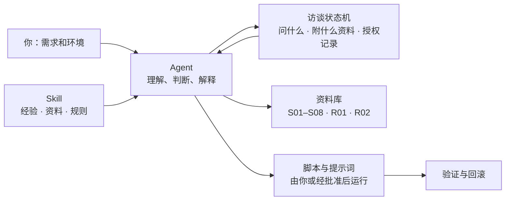
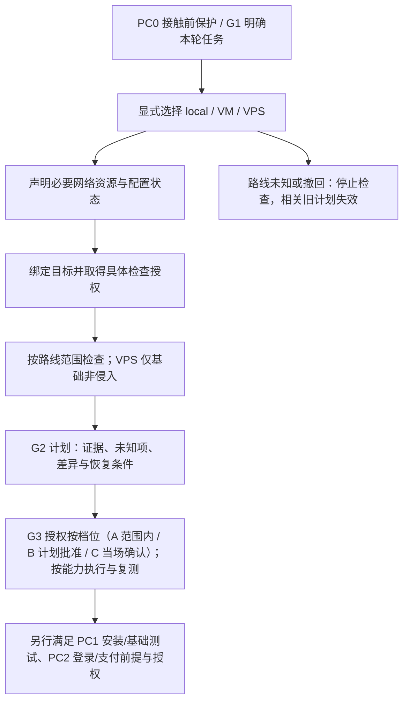

<div align="center">

# Claude-Guardian

**让 Agent 带着真实经验，陪你把 Claude 的使用环境准备好、查清楚、配稳。**

订阅前准备 · 账号注册与使用节奏 · 固定出口 IP · 本机 / VM / VPS 三条路线 · 防火墙与线路优化 · 分级授权

<p>
  
  
  
  <a href="https://github.com/DUNHKpcc/Claude-Guardian/actions/workflows/tests.yml"></a>
</p>

<p>
  <b>平台</b>
  
  
  
  
</p>

<p>
  <b>运行时</b>
  
  
  
  
  
</p>

<p>
  <b>网络与代理</b>
  
  
  
  
  
  
  
  
  
</p>

<p>
  <b>开发环境</b>
  
  
  
  
  
</p>

[它能干什么](#它能干什么) · [怎么工作](#怎么工作) · [分级授权](#分级授权你不需要每一步都在场) · [快速开始](#快速开始) · [选择运行路线](#选择运行路线) · [文档导航](#文档导航)

[GPL-3.0-only](LICENSE) · [更新记录](CHANGELOG.md) · [决策记录](docs/decisions.md) · [反馈问题](https://github.com/DUNHKpcc/Claude-Guardian/issues)

</div>

---

Claude-Guardian 是一个给 Agent 用的 Skill。它不是一键修复程序，而是把作者和社区的真实经验、一批经过整理的资料和少量脚本交给 Agent，让 Agent 能**根据你的需求和环境**，一步步陪你把订阅、账号、网络出口和运行环境准备好。每个人的系统、网络、预算和目标都不一样，所以它不给固定答案，而是先了解你，再给适合你的做法，并把风险高的步骤留给你拍板。

> **项目不承诺免封。** 检查通过、出口干净，都不代表平台认可你的网络环境；价格和准入变化快，购买前请核对官方页面。

## 它能干什么

| | 能力 | 具体做什么 |
| --- | --- | --- |
| 🧭 | **选路线** | 帮你在本机、虚拟机（VM）、远程服务器（VPS）之间选，说清每条路线的范围、代价和适合谁 |
| 🌐 | **固定出口 IP** | 介绍纯净机场、自建梯（可搭配家宽出口）、家宽拼车三种来源及优缺点；自建梯给 `3x-ui` + 优化线路 VPS 的简版提示；选 VPS 时附 17 份推荐报告 |
| 📝 | **注册与养号节奏** | 邮箱注册、Gmail / Outlook / Proton、Free → Pro → Max 的间隔、额度使用、教育邮箱；手机端（iOS / Android）防封检查表 |
| 💳 | **订阅与支付** | 按你的地区、设备、预算，从《AI 所有支付方式汇总》里挑候选并说明风险；付款始终由你本人完成 |
| 🖥️ | **VM 路线** | 客机系统（Omarchy / macOS）、LAN 独立网卡、搭建顺序，以及 `FlClash TUN` + `nftables` 的 fail-closed 防火墙脚本 |
| ☁️ | **VPS 路线** | 把 VPS 当开发机：Ubuntu 24.04、环境一致、`Xvfb + noVNC` 远程桌面、VS Code Remote-SSH、`tmux`、入站防火墙脚本 |
| 💻 | **本机路线** | Clash Verge / FlClash 的 TUN 与 DNS 引导，Windows 系统防火墙、Mac 的 LuLu，用提示词一步步带你配 |
| 🔒 | **整机统一出口** | 整机只走 IPv4、不走 IPv6：`TUN` 严格路由、DNS、规则兜底、泄漏与故障演练的取证清单（Mac、Windows），`egress_verifier.py` 按你实际观察到的证据判定 `established / violated / incomplete`，不回显 IP |
| 📈 | **线路优化** | Agent 逐项诊断并优化线路：SSH 动态转发、Realm 中转、BBR，每项都有原值记录和回滚 |
| 🩺 | **故障分流** | `403` / `429` / `529`、账单冲突、疑似凭据泄露：先暂停重试、整理证据，再给下一步 |
| 🧹 | **清理规划** | 规划旧设备 Claude 残留的清理，保护源码、Git 历史和 Codex；隔离（可恢复）由你在终端亲自确认，不永久删除；Windows 按官方路径用 PowerShell 分步清理 |
| 📚 | **资料随答附带** | 每个回答附上对应来源链接；资料之外需要补充时，可到 Linux.do、NodeSeek、V2EX、Reddit、X 查找并标明来源和日期 |

## 它不是什么

- **不是一键修复。** 内置的配置写入适配器目前只覆盖 Mac 上 Clash Verge Rev 2.5.8 的 rules 扩展（需先退出应用，未真机验收）；其他修改需要你批准，由你或 Agent 在你批准的范围内执行。
- **不替你付款、注册、登录、做 KYC 或 OAuth 授权。** 这些永远由你本人完成。
- **不收集凭据。** 不需要你提交 IP、订阅链接、密码、UUID 或完整配置。
- **不接触 Claude / Anthropic。** 接触前阶段（PC0）不启动客户端、不登录、不访问其服务。
- **没有在真实机器上验收。** 脚本和命令的语法与规则已测试，应用到真机的完整验收还在后面（见[开发与验证](#开发与验证)）。

## 怎么工作



- **Agent 主导：** 理解你的需求，选择资料，解释结果，决定下一步。同一个 Skill 对不同的人给出不同的做法。
- **状态机兜底：** 上百个访谈问题按条件调度，只在你明确选了路线后才问路线相关的问题；评估结果会列出这次**必须附上的资料**；授权记录可追溯。
- **脚本做有限的事：** VM 搭建、防火墙等脚本由你运行或经批准后运行，不由 Agent 临时改写。
- **硬规则不由 Agent 决定：** 接触门禁、付款本人、不收集凭据、宿主策略优先。

## 分级授权：你不需要每一步都在场

只有真正重要的点才需要你。改动按风险分三档，详见[分级授权](skills/claude-guardian/references/authorization-tiers.md)：

| 档位 | 你要做什么 | 包含什么 |
| --- | --- | --- |
| 🟢 **A 范围内自行做** | 路线和目标确定后，确认一次范围 | 只读诊断、查资料、出方案、预演 |
| 🟡 **B 整个计划批准一次** | 批准一张计划，Agent 连续执行，失败自动撤销 | 装客户端、加允许规则、前台转发、临时切 BBR、装 TUN |
| 🔴 **C 必须当场确认** | 到这一步 Agent 暂停，你什么时候看到什么时候回复 | 切默认出站为阻止、启用防火墙、改 SSH、持久化改内核、清理数据、账号与钱、凭据、组织设备、接触 Claude |

范围确认、计划批准和确认单都会记录在访谈状态里，来源必须是你的明确回复；换路线或会话恢复后自动失效，Agent 无法替你批准。

## 快速开始

### 1. 安装 Skill

将仓库中的 [`skills/claude-guardian`](skills/claude-guardian) 文件夹复制到你使用的 Codex Skill 目录，保留内部文件结构。分发时同时保留根目录的 [LICENSE](LICENSE)。

- 需要支持 Skills 的 Codex；脚本需要 **Python 3.10+**
- Skill 和参考文档可以直接阅读，不运行脚本也能查阅
- 项目不会自行安装 Python、代理工具或后台服务；部分静态 YAML 功能需要可选的 PyYAML，缺少时会停止并说明

macOS / Linux 在 Bash 中运行（已存在仓库时跳过 `git clone`）：

```bash
git clone https://github.com/DUNHKpcc/Claude-Guardian.git
(
  set -eu
  skill_root="$HOME/.codex/skills"
  mkdir -p "$skill_root"
  if [ -e "$skill_root/claude-guardian" ] || [ -L "$skill_root/claude-guardian" ]; then
    printf '%s\n' '目标已存在，停止安装；请先检查并备份现有 Skill，再手动迁移。' >&2
    exit 1
  fi
  cp -R Claude-Guardian/skills/claude-guardian "$skill_root/claude-guardian"
)
```

最终应有 `~/.codex/skills/claude-guardian/SKILL.md`。该命令遇到已有目标（包括符号链接）会停止，避免嵌套复制或覆盖自定义内容；更新时先检查差异并备份，再手动迁移需要的文件。

Windows 可手动下载或克隆仓库，在自己的 Codex Skill 目录（通常为 `%USERPROFILE%\.codex\skills`）中创建缺少的父目录，再复制完整的 `claude-guardian` 文件夹。确认最终为 `skills\claude-guardian\SKILL.md`；若同名目标已存在，先检查、备份并手动迁移，不直接合并或覆盖。

### 2. 在 Codex 中开始对话

```text
$claude-guardian
我第一次准备订阅 Claude，使用 Mac。先帮我比较本机和 VM，再决定怎么检查。
```

普通订阅准备会先确认订阅阶段，再按需了解系统、用途和目标。已有答案会复用；紧急故障和明确的清理任务走各自流程，不强行重做购买问卷。

### 3. 确认路线，再开始检查

**明确本轮任务 → 显式选择本机 / VM / VPS → 声明必要网络资源与配置状态 → 授权具体检查 → 执行检查 → 计划与分级授权**

路线选择只确定检查对象和深度，不等于允许联网、修改配置或保存资料。只想了解订阅或比较方案，可以停留在解释阶段。

## 选择运行路线

| 路线 | 适用方向 | 当前检查范围 |
| --- | --- | --- |
| **本机** `Clash Verge` `FlClash` `LuLu` `Windows Firewall` | 在自己的 Mac / Windows 上使用；默认建议，仍需明确接受 | 按目标和可用宿主能力做适用的详细检查；固定出口 IP 的来源（机场、自建梯、家宽拼车）见[出口来源](skills/claude-guardian/references/egress-ip-options.md) |
| **VM** `Omarchy` `macOS` `FlClash TUN` `nftables` | 在虚拟机内建立独立工作环境 | 按适用范围深入检查；宿主和客机分别绑定，不能互相替代结论；客机系统首选 Omarchy（Mac 宿主首选 macOS），网卡选 LAN 独立网卡，搭建顺序和防火墙脚本见 [VM 指引](skills/claude-guardian/references/vm-guidance.md) |
| **VPS** `Ubuntu 24.04` `Xvfb + noVNC` `Remote-SSH` `tmux` | 明确选择远程服务器作为开发机（Claude Code 跑在 VPS 上） | 基础、非侵入检查；环境一致、远程桌面、防火墙和线路优化的指引见 [VPS 指引](skills/claude-guardian/references/vps-guidance.md)；用户买好服务器并给出 SSH 后，Agent 可按分级授权通过 shell／SSH 部署（Skill 无内置部署程序，脚本未真机实测），买服务器和付款由用户完成 |

三条路线复用同一套入口与检测核心，差别在目标、范围和深度。原生采集取决于具体宿主支持；当前 `guardian.py check` 只支持本机 macOS / Windows，选择 VM 或 VPS 不会自动开放该命令的原生采集。它们是独立选择，不是升级顺序；已有 VPS、或把 VPS 用作网络出口，都不代表选择在 VPS 上运行。

选定路线后，先确认网络资源是否已有、选中哪个资源别名、代理入口与最终出口类型、配置是否准备好。**不用提交 IP、订阅链接、密码、UUID 或完整配置。** 没有资源、不确定或选择直连，也可以在明确目标和授权下做离线预检，不必先购买。

本地 HTTP/mixed 入口与上游 SOCKS5 出口是不同层，配置已导入也不等于已生效。详见[环境入口与路线边界](docs/environment-entry-decision.md)。

路线未知、仅比较、拒绝、撤回、过期或冲突时，不继续检查目标，也不能沿用先前的路线确认。路线、目标、资源或配置变化后，相关绑定、确认和旧计划失效，须重新核实；已有恢复义务仍保留。

## 核心场景

| 适用场景 | 需要解决的问题 | 当前处理方式 |
| --- | --- | --- |
| **订阅前准备与渠道核对** | 不清楚本机、VM、VPS 的区别，或付款渠道与商店地区前提 | 先确认订阅阶段和用途；需要环境检查时先选路线。逐项核对渠道前提，缺少条件时保留未知，不催促购买 |
| **代理与网络分流诊断** | 配置已导入但不确定生效，担心 DNS、IPv6 或 WebRTC 路径不符 | 在选定路线与具体授权下检查适用证据，按 Claude 目标流量 `IPv4_ONLY` 规划最小改动；主动端点探测另行授权 |
| **客户端异常与报错分流** | 遇到 `403` / `429` / `529`、账单冲突或疑似凭据泄露 | 先暂停非必要重试、整理已有证据，区分传输、认证、额度、账单和账号状态，再提出下一步 |
| **旧设备残留数据清理规划** | 需要整理 Claude 本地残留，同时保护项目源码、Git 历史和 Codex | 说明精确归属、保护项与隔离/恢复计划；清理接口默认无宿主适配器，不能据此宣称已可执行或已验收 |

## 工作流与门禁机制



- **PC0** 保持接触门禁关闭：不启动客户端、不执行 `claude --version`，不访问或解析 Claude / Anthropic 服务；诊断通过不会自动开启门禁。
- **G1 → G2 → G3** 分别组织事实收集、方案和按档位的授权（A 范围内自行做、B 计划批准一次、C 当场确认）。选择路线或完成问卷只满足部分入口前提，不能代替检查、修改或联网授权。
- **PC1 / PC2** 的客户端安装、基础测试、官方登录和支付有各自条件与授权；不是流程图走到末尾就可执行。VPS 采购和付款由用户本人完成；用户给出 SSH 访问后，Agent 可按分级授权通过 shell／SSH 执行文档里的命令和脚本来部署 VM 和 VPS（无内置部署程序，未真机实测）。

## 能力与边界

| 能力 | 当前能做什么 | 不能由此得出的结论 |
| --- | --- | --- |
| **分阶段访谈** | 复用事实、按条件提问、明确保存和中断续接 | 问卷完成不代表获得操作权限 |
| **限定只读诊断** | 在已授权、正确绑定的目标上采集支持的元数据；未知项保留未知 | 云端 Linux 的结果不能替用户 Mac / Windows 出具结论 |
| **离线分析与面板** | 整理本地结构化事实，生成静态状态快照和下一步建议 | 面板不是实时监控，输入报告不是本次认证的设备证据 |
| **修复计划与候选** | 生成限定范围的计划或私有差异，说明保护项与恢复条件 | 生成候选不代表已写入、应用生效或实际网络恢复 |
| **受限探测与恢复接口** | 供可信宿主按各自契约、精确范围和逐次授权调用 | 源码中有接口不代表默认 CLI 会调用，也不开放完整自动修复 |

清理的核心（计划、隔离到私有目录、对账、恢复）已实现。macOS 有内置宿主 `native_cleanup_mac.py`：只处理可再生缓存/日志和桌面端持久数据，`~/.claude` 里的对话记录、历史、设置、skills、插件、凭据始终受保护，要求 Claude 已退出且不由 Claude Code 启动，先做内容校验的私有备份，同意必须由你在真实终端里输入确认短语（任何标志、文件或 Agent 都不能代替），永久删除、钥匙串、浏览器数据不在范围内；它只有合成与 CI 测试，未真机验收。`native_claude_state_mac.py` 另有钥匙串退出登录、`CLAUDE_CODE_SIMPLE` 和用户指定时区三个独立命令（同样终端确认，不含设备标识轮换）。Windows 没有宿主，按官方路径写成了 [PowerShell 提示词](skills/claude-guardian/references/windows-cleanup.md)。其他平台普通运行 `cleanup_cli.py capabilities` 返回 `host_adapter_available=false`、`default_mutations=blocked_without_host`、`native_acceptance=not_run`，永久删除不受支持。POSIX 隔离/恢复夹具通过不代表用户设备清理已验收；详见[清理接口说明](docs/cleanup-cli-usage.md)。

默认 CLI 不自动联网、付款、清理或修改配置。网络探测必须另行确认端点与范围；受限 POSIX 事务和恢复接口有独立前提，不能把测试文件中的成功当成用户设备上的成功。

内置配置写入适配器只开放 Mac 上 Clash Verge Rev 2.5.8 的 `rules-prepend` 扩展（`native_clash_verge_mac.py`）：要求应用及其核心已退出，写入前后复查进程与元数据文件，检测到变化即失败并保留恢复批次；macOS 无强制文件锁，这只能发现不能阻止。其他系统、产品、版本和 `merge-policy` 的 `repair_cli.py execute` 仍受原生适配门禁阻塞。此适配器只有合成与 CI 测试，未真机验收。Agent 也可在独立的具体授权下，通过应用受支持的编辑与保存流程处理限定改动。现有辅助接口可为 Clash Verge Rev 2.5.8 的专属空 rules 扩展准备单条规则候选，并比较宿主实际供给的读回内容；它不操作应用，也不证明保存、载入、生效或恢复已完成。不能用临时脚本、保存的布尔值或回调绕过权限或原生接口门禁。详见 [Agent 修复流程](skills/claude-guardian/references/agent-remediation.md)和[单条 rules 扩展任务](skills/claude-guardian/references/agent-rules-task.md)。

### 开始前要知道

- **先确认，再接触服务**：PC0（接触前阶段）不启动 Claude 客户端、不登录、不访问其服务；阅读来源中的命令不构成执行授权
- **改动按风险分档授权**：只读和预演在确认范围后自行做；可自行撤销且不切断访问的改动，整个计划批准一次；可能锁死、涉及账号和钱、凭据、删除或不可逆的步骤必须当场确认。你不需要每一步都在场，详见[分级授权](skills/claude-guardian/references/authorization-tiers.md)
- **保护其他应用**：当前规划要求所选 Claude 目标流量仅用 IPv4、不回落 IPv6；这不是已生效声明，也不授权关闭整机 IPv6 或影响 Codex、VPN 和其他应用
- **只保存必要信息**：报告与私有差异按明确请求保存；不把凭据、真实 IP、订阅链接、原始配置或个人报告提交仓库

完整规则见[接触与授权边界](skills/claude-guardian/references/contact-and-safety.md)及[网络证据说明](skills/claude-guardian/references/network-and-remedies.md)。

## 使用示例

这些是向 Codex 发起任务的示例，不是已完成检查或修复的演示结果。

| 你想做的事 | 可以这样说 |
| --- | --- |
| 第一次准备订阅 | “我用 Windows，第一次准备订阅。先说明需要确认什么，再决定运行路线。” |
| 已选本机，想检查网络 | “这次在本机使用，代理配置已经导入。先确认资源和配置状态，只做我同意的检查。” |
| 比较 VM 和 VPS | “帮我比较这两条路线的检查范围，先不要检查设备或部署服务。” |
| 处理现有异常 | “当前 Claude Code 报错。先整理已有证据，区分已确认和未知项，再给最小修复建议。” |

<details>
<summary><strong>开发者：命令行入口</strong></summary>

以下命令在仓库根目录运行。完整访谈推荐 `interview_cli.py`；`guardian.py interview` 是兼容的简化入口。

```sh
python3 skills/claude-guardian/scripts/guardian.py --help
python3 skills/claude-guardian/scripts/interview_cli.py --target-ref laptop-a --account-ref account-a
```

`laptop-a` 和 `account-a` 是本地别名，不是设备或账号标识。访谈默认输出下一题和阶段评估，不默认保存；明确需要保存时使用 `--output`，续接按 [访谈说明](docs/interview-resume.md) 处理。

`check` 的目标绑定必须来自实际宿主与用户确认，不能补造授权。`analyze` / `plan` 处理本地结构化事实，样例见 [`tests/fixtures/`](tests/fixtures)。合成数据必须保留合成标记；导入报告不会恢复执行权限。完整契约见[清单说明](docs/inventory-cli.md)。

Windows 用户使用环境中实际可用的 Python 3 启动命令，例如 `py -3`。各入口的平台支持以对应帮助和文档为准；不能把核心跨平台测试等同于每个宿主接口均可用。

### CLI 与脚本索引

下列路径均位于 `skills/claude-guardian/scripts/`，命令从仓库根目录执行。帮助和能力查询不执行设备检查。

| 脚本 | 用途与边界 | 入口示例 |
| --- | --- | --- |
| `interview_cli.py` | 完整状态化访谈、单题调度和中断续接 | `python3 skills/claude-guardian/scripts/interview_cli.py --target-ref laptop-a --account-ref account-a` |
| `guardian.py` | 简化访谈、本机受控检查、离线分析与计划 | `python3 skills/claude-guardian/scripts/guardian.py --help` |
| `status_dashboard.py` | 读取已有报告，生成新的静态离线 HTML，不做新检查 | `python3 skills/claude-guardian/scripts/status_dashboard.py --input report.json --output dashboard.html` |
| `diagnostic_session.py` | 当前本机有限元数据会话，需要入口声明及现场终端确认；CLI 不开放 DNS | `python3 skills/claude-guardian/scripts/diagnostic_session.py --help` |
| `inventory_cli.py` | 能力查询、门禁状态和授权静态配置审计 | `python3 skills/claude-guardian/scripts/inventory_cli.py capabilities` |
| `agent_remediation.py` | 从本地报告选择结构化修复动作，不执行修复 | `python3 skills/claude-guardian/scripts/agent_remediation.py --help` |
| `repair_cli.py` | 精确文件预检、计划、差异与受门禁阻塞的执行；含 `rules-prepend` 候选 | `python3 skills/claude-guardian/scripts/repair_cli.py --help` |
| `recovery_cli.py` | POSIX 回执检查、协调与精确文件恢复，不能代替排他访问或操作授权 | `python3 skills/claude-guardian/scripts/recovery_cli.py --help` |
| `cleanup_cli.py` | 清理能力查询；其余操作依赖可信宿主，默认阻塞 | `python3 skills/claude-guardian/scripts/cleanup_cli.py capabilities` |
| `serve_webrtc.py` | 限时回环测试页；用户在浏览器确认后才发起 STUN，不能称为完全离线探测 | `python3 skills/claude-guardian/scripts/serve_webrtc.py --help` |

`report.json` 必须是已授权且符合输入契约的本地报告，`dashboard.html` 必须是尚不存在的新文件。CLI 示例中的别名、声明和输入文件都不构成真实设备证据或操作授权。

诊断会话在已核实的本机 macOS 可信宿主中，先由宿主依据本次明确选择准备当前入口声明，再使用绝对路径：

```sh
python3 skills/claude-guardian/scripts/diagnostic_session.py --target-ref laptop-a \
  --entry-file /approved-private-directory/entry.json
```

路径为占位示例；文件须满足 `environment_entry.require_entry(..., 'offline_precheck', 'laptop-a')`，随后仍需现场具体检查确认。当前 `--entry-file` 安全读取器仅支持 POSIX；Windows 不可照搬该命令，可信宿主须显式通过 `diagnostic_session.run(..., entry_request=...)` 或 `execute(..., entry_request=...)` 传入声明，并保留原有目标、权限和现场确认契约。不能用保存的问卷或伪造布尔值替代授权，详见[诊断会话](docs/diagnostic-session.md)和[环境入口](docs/environment-entry-decision.md)。

**保存与修改按各入口契约区分：**

- `interview_cli.py`、`guardian.py` 默认把结果写到 stdout，显式 `--output` 才另存新报告；`status_dashboard.py` 则要求 `--output` 指定新 HTML。
- `diagnostic_session.py` 把 JSON 写到 stdout；显式 `--dashboard-output` 可保存新 HTML，取消或拒绝时不保存，阻塞状态也可能生成报告，不能把保存成功视为检查通过。
- `repair_cli.py plan` 可通过 `--plan-file` 配合 `--backup-directory` 保留私有计划；`execute` 读取保留计划和摘要；仅 Mac 上 Clash Verge Rev 2.5.8 的 `rules-prepend` 范围放行，其余仍受 `NATIVE_REPAIR_ADAPTER_UNAVAILABLE` 阻塞。计划保存不代表目标配置已写入。
- `recovery_cli.py inspect / preview / reconcile` 只读核对指定回执与适用目标；`rollback / restore-prepared` 在精确范围、排他访问和现场确认成立后会恢复目标文件字节/模式，并可能按事务契约保留恢复记录，不使用 `--output` 作为写入开关。详见[离线恢复](docs/offline-recovery.md)。
- `cleanup_cli.py` 的宿主操作另有计划、回执与隔离/恢复契约（如 `--plan-output`、`--receipt-output`），默认缺少宿主时不能执行。`serve_webrtc.py` 会临时监听回环端口，不因没有 `--output` 就变成无副作用的离线解析器。

</details>

## 文档导航

| 从这里开始 | 内容 |
| --- | --- |
| [Skill 入口](skills/claude-guardian/SKILL.md) | 对话顺序、工具入口与按需加载规则 |
| [本机、VM 与 VPS](skills/claude-guardian/references/routes-and-platforms.md) | 路线选择、目标边界与生命周期 |
| [账号与支付准备](skills/claude-guardian/references/accounts-and-payments.md) | 订阅阶段、渠道前提与支付交接 |
| [账号注册与使用节奏](skills/claude-guardian/references/account-onboarding.md) | 邮箱、Free→Pro→Max 间隔、额度与教育邮箱 |
| [手机端防封要点](skills/claude-guardian/references/mobile-guidance.md) | iOS / Android 检查表，Android 拔 SIM 卡 |
| [固定出口 IP 的来源](skills/claude-guardian/references/egress-ip-options.md) | 机场、自建梯、家宽拼车，推荐与自建梯简版提示 |
| [本机的 Clash 与防火墙](skills/claude-guardian/references/local-firewall-prompts.md) | Windows 系统防火墙、Mac 用 LuLu，提示词引导 |
| [VM 指引](skills/claude-guardian/references/vm-guidance.md) | 客机系统、LAN 独立网卡、搭建顺序、fail-closed 防火墙 |
| [VPS 指引](skills/claude-guardian/references/vps-guidance.md) | 开发机、环境一致、远程桌面、防火墙 |
| [线路优化](skills/claude-guardian/references/line-optimization.md) | Agent 逐项诊断与优化线路，变更卡与回滚 |
| [网络与修复建议](skills/claude-guardian/references/network-and-remedies.md) | 代理、DNS、IPv4/IPv6、UDP/WebRTC 的证据解释 |
| [环境状态面板](docs/environment-dashboard.md) | 使用已有报告生成离线页面，不触发新检查 |
| [诊断会话](docs/diagnostic-session.md) | 限定采集、取消、保存与未知项 |
| [规则扩展候选](docs/rules-extension-plan.md) | 私有差异、输入绑定和当前执行限制 |
| [异常与清理](skills/claude-guardian/references/incidents-and-integrations.md) | 故障、保留范围、申诉和集成边界 |
| [来源资料库](skills/claude-guardian/references/source-library.md) | 按主题查阅随包原文、章节与来源 |

来源原文可以直接阅读，保留自身署名和许可。所有者提供的资料是本项目的依据，相关回答会附上对应来源；价格和准入变化快，购买前核对当前官方页面。

## 开发与验证

```sh
python3 -m unittest discover -s tests -v
python3 -m compileall -q skills/claude-guardian/scripts
python3 tools/package_skill.py --help
```

打包时使用 `--output` 指定你自己的临时目录中的新 ZIP 路径。测试与发行检查使用合成数据，不应指向真实代理配置或用户资料。

CI 在 Linux、macOS、Windows 上执行 2000 多个单测、回归与确定性打包检查，并另有面板预览检查。原生 smoke 与受控夹具只证明各自覆盖的范围，不能替代真实桌面、Clash、浏览器、写入或故障恢复验收。

**验收台账与证据已于 2026-10-21 移出仓库**（见 [ADR-010](docs/decisions.md)）。原 218 项验收要求仍写在 `skills/claude-guardian/sources/design/` 的设计规格中，可在 git 历史里找回台账；当前进展以 [CHANGELOG](CHANGELOG.md) 和 [决策记录](docs/decisions.md) 为准，不用单测数量代表产品完成度。

- [设计覆盖](docs/requirements.md)：已实现与未实现项
- [开发状态](docs/rebuild-status.md)：当前交付顺序与剩余工作
- [关键决策](docs/decisions.md)：设计取舍和确认条件
- [来源清单](docs/source-manifest.json)：设计输入版本与哈希

下一步仍包括真实 Mac / Windows 环境验证、精确修改与生效复测、冲突安全恢复，以及完整清理验收。当前可用的诊断和计划不会替代这些工作。

## Star History

[](https://www.star-history.com/?repos=DUNHKpcc%2FClaude-Guardian&type=date)

图表由 Star History 提供；加载受第三方服务可用性影响。

## 反馈与许可

欢迎通过 [Issues](https://github.com/DUNHKpcc/Claude-Guardian/issues) 反馈问题，或提交文档、合成样例和回归测试。反馈时说明系统、版本、复现步骤及预期结果；不要上传真实账号、凭据、订阅链接、完整代理配置或个人报告。

代码采用 **[GPL-3.0-only](LICENSE)**。来源原文保留其已有署名与许可声明。
