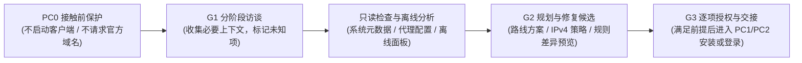

# Claude-Guardian

面向 Codex 的 Claude 环境准备、网络诊断与风险排查 Skill。许可证：**[GPL-3.0-only](LICENSE)**。

## 项目简介

在使用或订阅 Claude（Web、Desktop、Claude Code、API）时，本地历史残留、代理分流不完整（如 IPv6 旁路、DNS 泄露、WebRTC 暴露）、付款渠道与地区条件不匹配，以及异常报错后的盲目重试，都容易引发连接故障或账户风控风险。

**Claude-Guardian** 提供一套接触前（Pre-contact）的环境诊断与规划工作流。它在不主动接触 Claude/Anthropic 官方服务的前提下，协助用户完成以下工作：

1. **分阶段自适应访谈**：按需了解订阅阶段（首次订阅、到期重订、已有订阅）、操作系统（macOS / Windows）、目标客户端、历史经历与支付条件，自动复用已知信息并跳过无关问题。
2. **只读环境诊断与离线看板**：在明确授权范围内采集本机系统元数据与代理静态配置（如 Clash Verge / Mihomo），检查 IPv4/IPv6 策略、DNS、TUN/系统代理、WebRTC 等分流隐患，并支持生成纯静态离线 HTML 状态面板。
3. **路线规划与最小修复方案**：提供本机（默认推荐）、虚拟机（VM）、远程服务器（VPS）三套独立部署方案，核对 Apple / Google Play / 网页绑卡 / API 付款前提，并生成最小化、可回滚的配置修复与残留数据隔离计划。

> **能力与安全边界说明**：本项目用于排查本地环境缺口并规范操作流程，不承诺“免封”，不提供欺诈支付、身份伪造或非官方绕过方案；本地检查通过也不代表平台认可网络环境或授予服务准入资格。

---

## 核心功能与适用场景

| 适用场景 | 解决的问题 | 处理方式 |
| :--- | :--- | :--- |
| **订阅前准备与渠道核对** | 不清楚该选本机、VM 还是 VPS；不确定 Apple 礼品卡、App Store 地区或银行卡的前置要求，避免盲目购卡或重复扣款。 | 先确认订阅阶段与目标套餐，对比本机 / VM / VPS 路线差异，逐项核实各支付渠道与商店地区的硬性前提，条件未满足前阻断高风险购买建议。 |
| **代理与网络分流诊断** | 不确定客户端及子进程是否严格走代理，排查 IPv6 回退直连、DNS 泄露、WebRTC 暴露或代理规则优先级冲突。 | 默认按 Claude 目标流量纯 IPv4（`IPv4_ONLY`）策略核查；静态审计代理配置与扩展归属，在不影响内网、节点外层传输与 Codex 控制通道的前提下给出最小修复建议。 |
| **客户端异常与报错分流** | 遇到 `403` / `429` / `529` 报错、账单冲突、疑似停用或凭据泄露，需区分网络问题与账户状态。 | 优先暂停非必要的重试请求，区分网络传输/TLS 故障、认证冲突、额度限制、账单状态与账户限制，提供保护现有项目与凭据的处置步骤。 |
| **旧设备残留数据隔离与清理** | 设备曾登录过受限账号或需重置本地 Claude 环境，同时需防止误删项目源码、Git 历史或 Codex 配置。 | 提供精细化清理规划与可恢复的私有隔离（Quarantine），默认保护项目源码、未提交修改、Codex 与无关应用，仅处理核实归属 Claude 的本地目录。 |

---

## 工作流与门禁机制

项目通过**接触门禁（PC0 → PC1 → PC2）**与**阶段门禁（G1 → G2 → G3）**控制操作边界，避免在环境就绪前产生意外联网或未授权修改：



- **PC0（接触前阶段）**：默认起点。不访问 Claude/Anthropic 网页、API、DNS 或文档，不执行 `claude --version` 或客户端启动命令，仅依赖本地只读元数据与随包参考资料完成准备。
- **G1 → G2（访谈到方案）**：完成适用分支的信息收集（G1）后，生成带证据链与回滚要求的个性化方案（G2）；缺失或拒答项以条件式计划呈现。
- **G3 → PC1 / PC2（授权执行与交接）**：本地配置修改、客户端安装与基础连通测试（PC1）、官方登录与支付操作（PC2）相互独立，均需满足对应前置条件并获得明确范围授权。

---

## 安装与使用

### 环境要求

- **宿主环境**：支持 Skills 的 Codex 会话。
- **运行依赖**：Skill 文本可独立阅读；调用脚本需要 **Python 3.10+**。项目不会自动安装 Python 依赖、代理软件或后台服务。

### 安装步骤

将仓库中的 `skills/claude-guardian` 文件夹复制到你使用的 Codex Skill 目录，保留原有文件结构（分发发行包时需附带根目录 `LICENSE`）：

```bash
git clone https://github.com/DUNHKpcc/Claude-Guardian.git
cp -r Claude-Guardian/skills/claude-guardian ~/.codex/skills/
```

### 会话调用示例

在支持 Skills 的 Codex 会话中调用 `$claude-guardian`。Agent 会先复用你已说明的事实，再分轮提问并仅执行授权范围内的检查：

- **首次订阅准备**：“`$claude-guardian` 帮我准备第一次订阅 Claude，先检查我的 Mac 环境。”
- **代理与分流排查**：“`$claude-guardian` 我已有 Pro 订阅，在 Windows 上使用 Clash Verge，帮我检查网络分流和 IPv4-only 策略是否有缺口。”
- **本地数据清理规划**：“`$claude-guardian` 这台电脑之前登录过受限账号，帮我规划清理本地 Claude 残留数据，同时保留本地项目代码和 Codex。”
- **到期重订与旧账单处理**：“`$claude-guardian` 以前通过 Apple 订阅过但已到期，准备重订 Pro，先帮我梳理旧账单和重订前提。”

---

## CLI 与脚本索引

`skills/claude-guardian/scripts/` 提供离线核心与只读采集接口。默认输出到标准输出（`stdout`），仅在显式指定 `--output` 时保存文件：

| 脚本 | 说明 | 示例命令 |
| :--- | :--- | :--- |
| `interview_cli.py` | **完整状态化访谈入口（推荐）**：支持 95+ 稳定问题 ID 条件调度、单题输出、本地 JSON 答案提交及中断续接（`--resume`）。 | `python3 skills/claude-guardian/scripts/interview_cli.py --target-ref laptop-a --account-ref account-a` |
| `guardian.py` | **基础 CLI 入口**：提供兼容简化访谈（`interview`）、受控本机检查（`check`）、离线事实分析（`analyze`）与修复计划（`plan`）。 | `python3 skills/claude-guardian/scripts/guardian.py --help` |
| `status_dashboard.py` | **离线状态面板生成**：将已授权的本地报告（`guardian-report/0.1` 或 `env-inventory/0.2`）投影为纯静态离线 HTML。 | `python3 skills/claude-guardian/scripts/status_dashboard.py --input report.json --output dashboard.html` |
| `diagnostic_session.py` | **窄范围终端元数据会话**：展示精确采集范围，需在 30 秒内输入终端随机 nonce 确认（60 秒上下文期限）。 | `python3 skills/claude-guardian/scripts/diagnostic_session.py --target-ref laptop-a` |
| `inventory_cli.py` | **静态盘点与门禁状态**：查看当前开放能力（`capabilities`）、门禁状态（`workflow-status`）及授权配置文件静态审计（`static-audit`）。 | `python3 skills/claude-guardian/scripts/inventory_cli.py capabilities` |
| `agent_remediation.py` | **Agent 修复动作选择器**：根据本地报告生成结构化动作清单，区分只读脚本、候选计划与 Agent 独立修复。 | `python3 skills/claude-guardian/scripts/agent_remediation.py select --input report.json --target-ref laptop-a` |
| `repair_cli.py` | **内部修复与规则候选入口**：提供精确文件的 `preflight / plan / diff / execute` 接口及 Clash Verge 2.5.8 `rules-prepend` 候选生成。 | `python3 skills/claude-guardian/scripts/repair_cli.py --help` |
| `recovery_cli.py` | **POSIX 独立恢复入口**：只读核对回执（`inspect / reconcile`），或在满足排他与确认前提下执行回滚（`rollback / restore-prepared`）。 | `python3 skills/claude-guardian/scripts/recovery_cli.py --help` |
| `serve_webrtc.py` | **本地 WebRTC 自测服务**：限时绑定 `127.0.0.1` 提供固定测试页（`assets/webrtc-probe.html`），由用户自行在浏览器打开确认后发起单次 STUN。 | `python3 skills/claude-guardian/scripts/serve_webrtc.py --help` |

---

## 目录结构

- `skills/claude-guardian/SKILL.md`：Skill 主入口与编排规则
- `skills/claude-guardian/references/`：按需加载的访谈、路线、支付、网络、故障与证据说明
  - `intake.md`：M00 自适应访谈调度、问题 ID 与中断续接规则
  - `contact-and-safety.md`：接触门禁（PC0–PC2）与执行权限边界
  - `routes-and-platforms.md`：M01/M06–M09 本机、VM、VPS 三路线规划与操作卡
  - `accounts-and-payments.md`：M02/M03 准入核验与 Apple / Google Play / Web / API 支付前提
  - `network-and-remedies.md`：M04/M05/M10 代理、DNS、IPv4-only、WebRTC 证据解释与最小修复
  - `incidents-and-integrations.md`：M07/M10–M13 异常分流、SDK/MCP 边界与本地数据清理规划
  - `agent-remediation.md`：Agent 驱动修复、规则范围与恢复流程
  - `source-library.md`：随包公开资料索引与许可声明
- `skills/claude-guardian/scripts/`：离线核心、只读采集与受控辅助脚本
- `skills/claude-guardian/sources/`：脱敏参考资料与设计基线（D-SPEC v0.1.10 / D-ENV v0.3）
- `docs/`：需求覆盖（`requirements.md`）、关键取舍（`decisions.md`）、输入哈希清单（`source-manifest.json`）及验证记录
- `tests/`：单元测试、行为回归测试与合成夹具（`tests/fixtures/`）
- `tools/`：确定性打包脚本（`package_skill.py`）与面板校验工具

---

## 当前版本状态与实现边界（v0.2.0）

设计基线为主规范 v0.2.00 与环境脚本规范 v0.3。项目严格区分**设计文档、代码实现、合成夹具验证与真实设备实测**状态，不将“有文档”或“合成测试通过”表述为“已在用户设备验收完成”：

1. **适用平台与采集范围**：
   - 本机主线为 macOS / Windows（云端 Linux 环境不能替代用户本地电脑出具检查结论）；VM 与 VPS 为独立可选路线。
   - 原生只读采集覆盖系统产品/构建版本、语言偏好、时区和代理/PAC 启用状态；macOS 另记录采集进程架构与固定枚举的路径诊断（不输出敏感路径，硬件与转译状态仍记为未知）。不读取代理凭据或订阅内容。
2. **内部修复与规则扩展候选（`repair_cli.py`）**：
   - 交互方式为“对话确认后由可信宿主调用固定内部脚本”，不要求用户再到终端输入二次确认码。
   - 显式 `rules-prepend` 路线已接入同一 CLI，可结合 `clash_verge_258.py` 校验所提供的 2.5.8 归属链，为空 `prepend: []` 的 rules 扩展生成有界候选并保留输入快照。
   - **实际写入仍阻塞**：当前实际 Clash 版本/扩展归属的原生实机适配尚未开放，`execute` 门禁始终返回 `NATIVE_REPAIR_ADAPTER_UNAVAILABLE`。详见 [Agent 修复流程](docs/agent-repair-flow.md) 与 [规则扩展候选](docs/rules-extension-plan.md)。
3. **配置候选、探测库与事务边界**：
   - `config_edit_plan.py` 仅在内存中构建私有字节差异（`apply_supported=false`），无配置写入入口，也不证明 GUI 合并或完整分流结果，详见 [配置候选](docs/config-edit-plan.md)。
   - `diagnostic_session.py` 提供明确授权后的有限元数据流程，CLI 无 DNS 开关；`network_probes.py`、`stun_probe.py`、`mihomo_dns_probe.py`、`os_dns_probe.py` / `windows_dns_probe.py` 均为受控宿主库，不由主 CLI 自动调用，详见 [诊断会话](docs/diagnostic-session.md) 与 [验证记录](docs/validation.md)。
   - `transactions.py`、`recovery_cli.py` 与 `cleanup_transactions.py` 提供 POSIX 限定范围文件事务/隔离基础，不是已验收的系统/Clash 写入适配器，Windows 原生事务尚未实现。
4. **离线报告导入与防伪边界**：
   - `guardian.py analyze/plan` 导入 `env-inventory/0.2` 时，仅接受当前 `guardian.native_check` 生成的完整信封结构，拒绝手写精简对象、未知字段或疑似凭据形式；制作离线样例需使用 `guardian-offline/0.1` 合约。
   - 合成报告始终保留 `synthetic_example` 标记；导入真实设备格式也仅作为未经本次认证的用户提供观察，不自动通过原生验收、接触或执行门禁。详见 [导入与导出边界证据](docs/evidence/rebuild-inventory-export-boundaries.md)。

---

## 发布、隐私与开发测试

- **隐私与数据安全**：测试与发行包仅使用合成数据。用户画像、原始代理配置、订阅地址、账号、凭据、真实 IP 和个人报告不得提交仓库。随包来源资料已去除个人机器记录，参阅 [来源资料库](skills/claude-guardian/references/source-library.md)。
- **CI 自动检查**：每个 push / PR 在 Linux、macOS、Windows CI 上运行单测、回归和确定性打包检查；macOS / Windows CI 另运行只读 OS 元数据 smoke 测试（smoke 测试不代表真实用户桌面、Clash、浏览器或故障恢复已验收通过）。

本地运行测试与打包：

```bash
python3 -m unittest discover -s tests -v
python3 tools/package_skill.py --output /tmp/claude-guardian-0.2.0.zip
```
