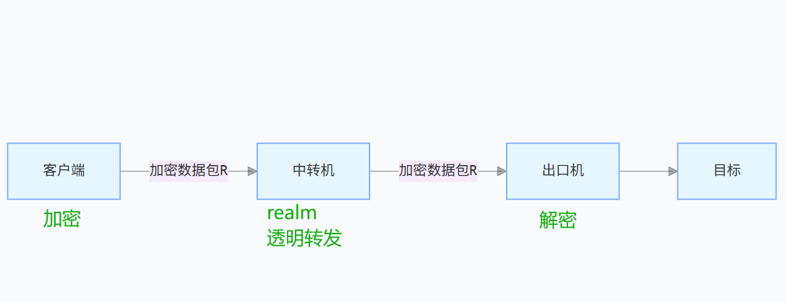
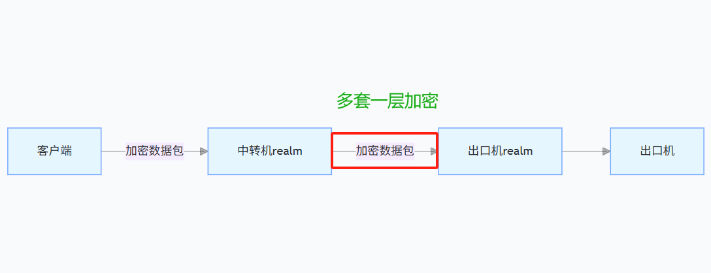

# VPS 线路优化与家宽中转教程

> 整理日期：2026-10-17；适用环境：Linux VPS，示例以 Ubuntu / Debian 为主。
> 推荐指数：🌟🌟🌟🌟 / 5；适用方向：业务。
> 评分针对“美西优化线路机＋固定家宽出口”方案：连接与出口可以分别选择，但增加了一台机器的成本和维护工作。

**先选好线路，再考虑中转，最后按需要调整 TCP 和桌面画质。** 对 Claude 浏览器和远程桌面，更值得关注的是晚高峰连接稳定、操作响应及时、实际出口符合预期，而不是一次测速跑得多高。

本文结合 Linux.do、NodeSeek、V2EX 的教程与讨论整理；命令按项目文档核对。属于操作指南，没有在你的服务器上执行配置或产生新的实测成绩。

## 一、先弄清楚要优化什么

| 遇到的问题 | 优先处理 |
|---|---|
| 晚上直连慢、绕路或频繁断流 | 更换适合本地运营商的线路，或增加中转 |
| 小流量正常，大文件传输效率差 | 检查方向差异、重传，再考虑 TCP 拥塞控制 |
| 下载一跑满，桌面就卡 | 给下载限速、留带宽余量，必要时处理排队 |
| 桌面能用，但网站看到的 IP 不对 | 配置浏览器的出站代理 |
| 画面卡，CPU 同时很高 | 降低分辨率和画质，检查浏览器及桌面负载 |

**BBR 调整 TCP 拥塞控制，不能把普通线路变成 CN2 GIA；更换 DNS 也不会直接替换运营商的国际路由。** [Linux 内核说明](https://www.kernel.org/doc/html/latest/networking/ip-sysctl.html)明确区分了拥塞控制等 TCP 参数。

## 二、选美西与三网优化：看自己的那条路

美西可以作为美国出口的候选位置；是否更快，要看你到机房以及机房之间的实际互联。“三网优化”需要分别核对电信、联通、移动，去程、回程与 IPv4、IPv6 也分开判断。

选机时按这个顺序：

1. 确认本地运营商和目标地区。
2. 看对应套餐、同机房的路由资料，优先看自己常用时段。
3. 有两台机器时，同时看“本地 → A”和“A → B”，增加一跳后仍要有收益。
4. 核对两台机器各自的流量计费方向、可用端口和剩余流量。

[V2EX 的国内云中转讨论](https://www.v2ex.com/t/1177513)就涉及晚间连接海外 VPS 不稳定的问题；讨论中的经验提示，增加一台云服务器能否改善连接，仍取决于它与目标机器的互联。不能只凭云厂商品牌或地理距离下结论。

候选机器可结合现有文档选择：

- 线路与业务：[VPS-推荐报告-DMIT 产品线与美西线路 🌟🌟🌟🌟](vps-recommendations/biz-dmit.pdf)。
- 性价比线路：[VPS-推荐报告-VMISS 美西三网优化 🌟🌟🌟🌟](vps-recommendations/value-vmiss.pdf)、[VPS-推荐报告-VMRACK L3 三网优化 🌟🌟🌟](vps-recommendations/value-vmrack.pdf)、[VPS-推荐报告-搬瓦工 MINIBOX与MegaBOX 🌟🌟🌟🌟](vps-recommendations/value-bandwagon.pdf)。
- 家宽出口：[VPS-推荐报告-NodeMach(VIRCS) 🌟🌟🌟🌟🌟](vps-recommendations/home-nodemach.pdf)、[VPS-推荐报告-AaITR 美日家宽与静态线路复测 🌟🌟🌟🌟](vps-recommendations/home-aaitr.pdf)。

这些是候选资料，不代表不同套餐和日期的线路都相同。

## 三、两种搭配方法

约定 **A＝优化线路 VPS，B＝家宽出口 VPS**。

### 方案 A：浏览器放在 A，网站请求从 B 出去

```text
本地电脑 ──远程桌面──> A：浏览器 / 虚拟显示
                           │
                           └──加密连接──> B：家宽出口 ──> 网站
```

适合希望远程桌面连接稳定、同时使用固定家宽出口的场景。浏览器运行在 A，必须在这个浏览器中配置通往 B 的代理。

### 方案 B：浏览器或服务放在 B，A 只做中转

```text
本地电脑 ──> A：端口中转 ──> B：桌面 / 服务 ──> 网站
```

适合 B 已有可用桌面或服务，但本地直连 B 较差的情况。B 需要承担浏览器和桌面的计算负载。

[Linux.do 的 Realm 教程](https://linux.do/t/topic/920558)用 SSH 演示了单端中转，下面的链路图可用于理解方案 B；图中端口和机器名称是教程示例。



**把连接桌面的入口转发了，不等于把浏览器的出口改了。** [NodeSeek 的 Realm 功能说明](https://www.nodeseek.com/post-391214-1)也区分了端口转发与链式代理。先确定程序运行在哪台机器，再决定在哪里配置出站。

## 四、推荐入门操作：用 SSH 连接家宽出口

以下使用方案 A。前提是：A 已有浏览器，B 的 SSH 可以从 A 访问，并允许 TCP 转发。先把命令中的大写占位项换成自己的信息，不要连尖括号一起执行。

### 1. 在 A 上建立 SOCKS5 入口

在 **A 的终端**执行，填写 B 的 SSH 端口、用户和地址：

```bash
ssh -N -D 127.0.0.1:1080 -p B_SSH_PORT \
  -o ServerAliveInterval=30 -o ServerAliveCountMax=3 \
  B_USER@B_IP
```

这会在 A 的 `127.0.0.1:1080` 提供 SOCKS 入口，连接通过 SSH 到 B，再由 B 访问目标。首次连接核对 B 的主机指纹；保留此终端，按 `Ctrl+C` 即可停止。此示例是前台连接，不包含开机启动配置。[OpenSSH 动态转发说明](https://man.openbsd.org/ssh#D)

### 2. 在 A 的浏览器里设置代理

- 类型：SOCKS5。
- 地址：`127.0.0.1`；端口：`1080`。
- 浏览器支持时，启用通过 SOCKS5 解析域名。

这里的 `127.0.0.1` 指 **A 自己**。如果浏览器运行在容器里，容器的本地地址指向容器，需要另行配置可达的代理地址，不能直接照填。

### 3. 确认出口

在 A 另开终端：

```bash
curl --proxy socks5h://127.0.0.1:1080 https://api.ipify.org
```

返回值应为 B 的预期公网出口；NAT 产品的公网出口可能与 SSH 入口不同。`socks5h` 让该请求的域名由代理端解析，见 [curl 说明](https://curl.se/docs/manpage.html#--socks5-hostname)。

再在**已设置代理的浏览器**中确认出口。curl 成功只证明这一条请求走通，不能证明浏览器的 DNS、WebRTC 或其他进程全部使用同一出口。最后以实际网站访问结果验收；IP 标签和解锁脚本不能保证 Claude 账号状态。

## 五、Xvfb / noVNC：让桌面连接更轻

[Xvfb](https://xorg.freedesktop.org/releases/X11R6.8.2/doc/Xvfb.1.html)提供虚拟显示。要看见并操作画面，还需要浏览器或桌面程序、VNC 服务端，以及客户端；[noVNC](https://github.com/novnc/noVNC#server-requirements)是网页 VNC 客户端，通常配合 WebSocket 服务使用。

下面只说明已安装桌面的连接方式，不包含完整桌面安装。

假设 A 的 VNC 服务已经监听 `127.0.0.1:5901`，且已取得 noVNC。在 **A 的 noVNC 目录**启动本地网页入口：

```bash
./utils/novnc_proxy --vnc 127.0.0.1:5901 --listen 127.0.0.1:6080
```

在 **自己的电脑**建立本地转发：

```bash
ssh -N -L 127.0.0.1:6080:127.0.0.1:6080 -p A_SSH_PORT A_USER@A_IP
```

然后打开本地的 `http://127.0.0.1:6080/vnc.html`，进入 VNC 连接。示例中的网页入口仅监听本地地址，通过 SSH 访问；如果已有桌面面板，使用其实际地址和认证方式即可。[noVNC 启动示例](https://github.com/novnc/noVNC#quick-start)、[SSH 本地转发](https://man.openbsd.org/ssh#L)

画面设置可以从 **1280×720** 开始。软件支持时降低画质、帧率上限，关闭不必要的视频和动态背景；这是减少画面传输量的起点，不是统一硬件门槛。带宽不足时先保留文字可读性，再追求清晰度。不同客户端可调项目不同，可参考 [KasmVNC 的画质与帧率设置](https://www.kasmweb.com/kasmvnc/docs/latest/clientside.html)。

## 六、需要端口中转时：Realm 最小示例

采用方案 B，或者想先改善 SSH 到 B 的连接时，可以只在 A 安装 Realm。安装包选择与系统架构匹配的 [Realm 发布版本](https://github.com/zhboner/realm/releases)，本节假设 `realm` 已可执行。

在 A 保存 `config.toml`，将 B 的地址和真实 SSH 端口填好：

```toml
[[endpoints]]
listen = "0.0.0.0:2222"
remote = "B_IP:B_SSH_PORT"
```

在该文件所在目录启动：

```bash
realm -c config.toml
```

在 A 的云防火墙和系统防火墙中，给自己的公网 IP 放行 TCP 2222。随后在本地连接：

```bash
ssh -p 2222 B_USER@A_IP
```

最终登录的是 B，主机指纹应核对 B。这个前台示例按 `Ctrl+C` 停止；同一监听端口不能同时被其他程序占用。配置语法见 [Realm 官方说明](https://github.com/zhboner/realm#configuration)。

已有加密业务可以按其协议转发；普通端口转发本身不提供额外加密。需要双端隧道、流量统计等功能时，可进一步阅读 [NodeSeek 的脚本教程](https://www.nodeseek.com/post-391214-1)，双端链路的形态如下：



此图用于理解双端封装；不是前面 SSH 方案必须增加的一层。中转收益取决于两段连接，不能保证加入 A 就一定更快。

## 七、BBR：作为可选调整，先保留原值

在需要调整的 Linux VPS 上查看当前配置：

```bash
sysctl net.ipv4.tcp_congestion_control
sysctl net.ipv4.tcp_available_congestion_control
sysctl net.core.default_qdisc
tc qdisc show
```

记下原拥塞算法。可用列表没有 `bbr` 时，可以尝试加载系统自带模块，再查看一次：

```bash
sudo modprobe tcp_bbr
sysctl net.ipv4.tcp_available_congestion_control
```

只有列表中存在 `bbr` 时才继续；模块不可用就先跳过，不需要为了完成教程更换内核。

先临时切换：

```bash
sudo sysctl -w net.ipv4.tcp_congestion_control=bbr
```

它是新建 TCP 连接的默认算法，已经建立的连接不会因此全部切换。重连实际业务后，观察同一用途是否有改善；效果不好，就将命令末尾的 `bbr` 换回刚才记录的原值。[内核 TCP 参数说明](https://www.kernel.org/doc/html/latest/networking/ip-sysctl.html#tcp-variables)

确定保留、且不存在同名配置文件时，再持久化：

```bash
printf '%s\n' 'net.ipv4.tcp_congestion_control=bbr' | \
  sudo tee /etc/sysctl.d/90-vps-bbr.conf
sudo sysctl -p /etc/sysctl.d/90-vps-bbr.conf
```

之后撤销，需要删除自己新增的这一文件，并恢复记录的原算法；只删除文件不会立即恢复运行值。

`default_qdisc` 与当前实际网卡队列分开看；多队列设备还可能显示 `mq`，虚拟设备可能是 `noqueue`。已有队列配置时先保留，避免直接覆盖 CAKE 或其他整形规则。[内核队列说明](https://docs.kernel.org/admin-guide/sysctl/net.html#default-qdisc)

## 八、卡顿时按现象处理

| 现象 | 下一步 |
|---|---|
| 只在晚高峰明显变差 | 比较常用时段的直连与中转，优先处理线路 |
| A 正常，A 到 B 特别慢 | 检查两机互联及方向差异，有 IPv6 时比较该段 IPv4 / IPv6 |
| Ping 好看，业务依然慢 | 看实际业务吞吐与重传，不用 Ping 代替业务结果 |
| 一下载就卡 | 先限制大流量任务，给桌面留余量；仍有排队再考虑整形 |
| 只有画面卡，文字请求正常 | 降画质与分辨率，检查 CPU 是否被占满 |
| 出口没有变化 | 检查代理配置在本地电脑、A 还是容器，以及浏览器是否实际使用 |

[NodeSeek 的 DMIT 品川与 Zouter 排障记录](https://www.nodeseek.com/post-902010-1)中，终点延迟较低且没有显示丢包，实际 TCP 两个方向却差异明显；改用两机间的 IPv6 后，部分 TCP 业务恢复。记录中的清洗原因仍属推断，不能推广为所有 DMIT 或 IPv4 线路的问题，也不能推导出 IPv6 一定更快。

只做必要验收：桌面操作顺畅、出口符合预期、常用业务连接稳定。每次只改变一个因素，避免同时更换内核、代理协议、DNS 和十几项参数后无法判断原因。

## 综合评价

**已有一台好用的家宽机，就先直连；直连确实拖慢使用，再增加优化线路机。** 两机方案里，A 负责连接与计算，B 负责出口。浏览器放 A 时设置出站代理，浏览器放 B 时改善访问 B 的入口。

视频里可以简单讲：**“线路看三网和晚高峰，桌面看响应，家宽看实际出口。连接不稳先换路，画面卡先降负载，最后再考虑 BBR。”**
